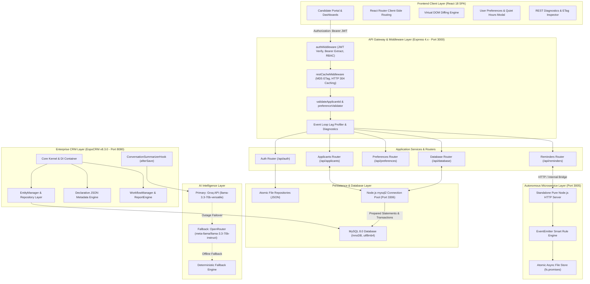
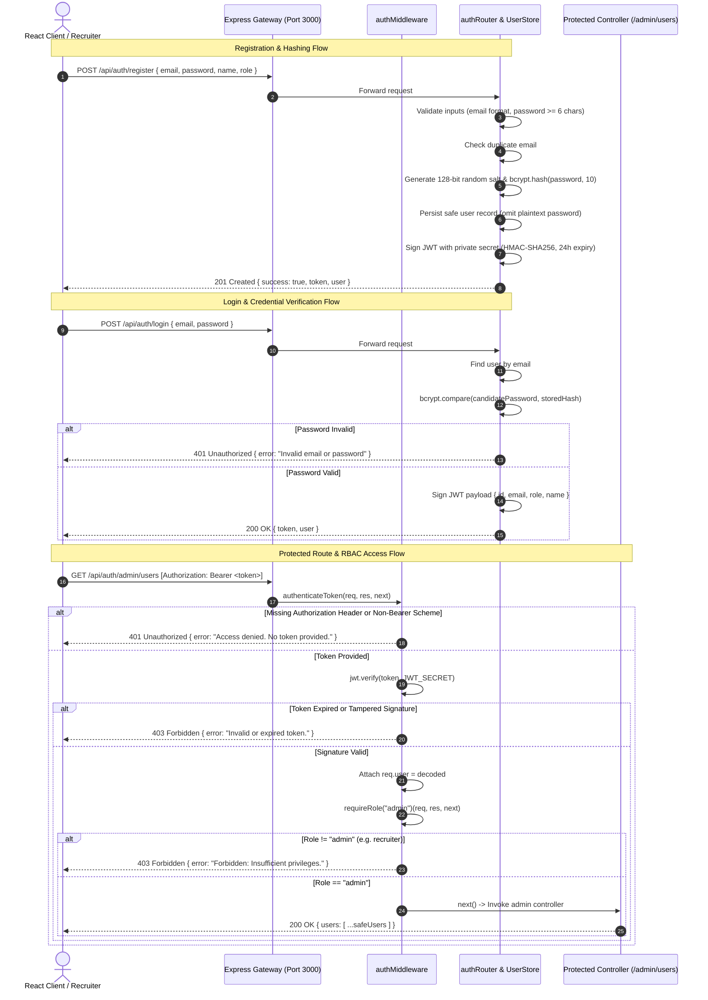
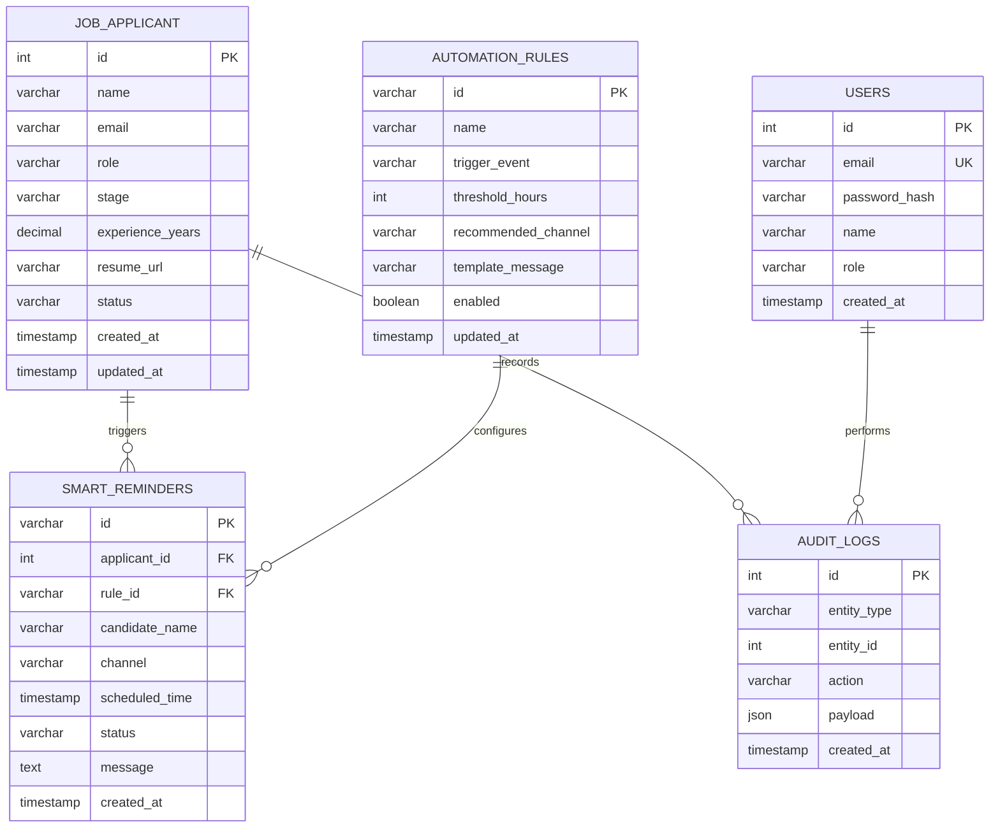

# System Architecture Blueprint — Cynaris Recruitment Platform & EspoCRM Fork

**Author:** Murali  
**Version:** 2.0 (Week 4 Production Release)  
**Target Platform:** Node.js 18+ (Express 4.x), EspoCRM v8.3.0 (PHP 8.2-FPM), MySQL 8.0, React 18  
**Live Production:** [Railway Production](https://cynaris-recruitment-production.up.railway.app) | [Render Staging](https://cynaris-recruitment.onrender.com)  

---

## 1. High-Level Architecture Overview

The **Cynaris Recruitment Platform** is an enterprise-grade applicant tracking and recruitment workflow platform. It combines a decoupled **React 18 Single-Page Application (SPA)** frontend, a **Node.js / Express REST API** application server, an autonomous **Smart Reminders Microservice**, an **EspoCRM v8.3.0** customer relationship management engine, an **AI Intelligence layer** (Groq + OpenRouter), and a high-performance **MySQL 8.0** relational database with connection pooling.



---

## 2. Core Architectural Principles

1. **Stateless Security (JWT + Bcrypt):**
   - User authentication does not persist session state on the server. Authentication is encapsulated in cryptographically signed JSON Web Tokens (`HMAC-SHA256`).
   - Passwords are never stored in plaintext. They are salted and hashed using `bcrypt` ($2^{10}$ salt rounds).
   - Strict separation between **401 Unauthorized** (missing or invalid credentials) and **403 Forbidden** (forged tokens, expired signatures, or insufficient RBAC privileges).

2. **Database Performance & Injection Immunity:**
   - Database operations use `mysql2/promise` connection pooling (`connectionLimit: 10`, `waitForConnections: true`, `enableKeepAlive: true`).
   - All SQL queries strictly use **parameterized prepared statements (`?` placeholders)**, completely neutralizing SQL injection vectors.
   - Critical operations (such as stage advancement with audit logging) run inside **atomic transactions** (`beginTransaction`, `commit`, `rollback`).

3. **HTTP Performance & Bandwidth Optimization:**
   - Conditional request revalidation via weak entity tags (`W/"<md5>"`).
   - Matching `If-None-Match` requests immediately return **HTTP 304 Not Modified** with a **0-byte payload**, preventing unnecessary database queries and network saturation.
   - Sub-millisecond Event Loop latency monitoring via `setImmediate` and `process.hrtime.bigint()`.

4. **Resilient AI Pipeline with Multi-Tier Failover:**
   - AI summarization and timing optimization leverage **Groq** (`llama-3.3-70b-versatile`) as primary engine (< 300ms latency).
   - Automatic failover to **OpenRouter** (`meta-llama/llama-3.3-70b-instruct`) upon rate limits (HTTP 429) or service outages (HTTP 503).
   - Deterministic local rule fallback ensures zero system downtime during total external API outages.

---

## 3. Stateless JWT Authentication & RBAC Lifecycle

The authentication lifecycle is completely decoupled from database sessions, enabling zero-overhead horizontal scaling:



### Authentication Token Schema
- **Header:** `{"alg": "HS256", "typ": "JWT"}`
- **Payload (Claims):**
  ```json
  {
    "id": 1,
    "email": "admin@cynaris.com",
    "role": "admin",
    "name": "System Administrator",
    "iat": 1730635200,
    "exp": 1730721600,
    "iss": "cynaris-recruitment-platform",
    "aud": "cynaris-client"
  }
  ```
- **Signature:** `HMACSHA256(base64UrlEncode(header) + "." + base64UrlEncode(payload), JWT_SECRET)`

---

## 4. Database Architecture & Schema Definitions

The platform persists relational recruitment data, automation rules, smart reminders, and audit history in **MySQL 8.0** (`espocrm` database, InnoDB engine, `utf8mb4_unicode_ci` collation).



### Key DDL Specifications
1. **`job_applicant` Table:**
   ```sql
   CREATE TABLE IF NOT EXISTS job_applicant (
       id INT AUTO_INCREMENT PRIMARY KEY,
       name VARCHAR(255) NOT NULL,
       email VARCHAR(255) NOT NULL,
       role VARCHAR(150) NOT NULL,
       stage ENUM('Screening', 'Technical Round 1', 'Technical Round 2', 'HR Round', 'Offered', 'Hired', 'Rejected') NOT NULL DEFAULT 'Screening',
       experience_years DECIMAL(4, 1) NOT NULL DEFAULT 0.0,
       resume_url VARCHAR(500),
       status ENUM('Active', 'Withdrawn', 'Closed') NOT NULL DEFAULT 'Active',
       created_at TIMESTAMP DEFAULT CURRENT_TIMESTAMP,
       updated_at TIMESTAMP DEFAULT CURRENT_TIMESTAMP ON UPDATE CURRENT_TIMESTAMP,
       INDEX idx_stage (stage),
       INDEX idx_email (email),
       INDEX idx_created (created_at)
   ) ENGINE=InnoDB DEFAULT CHARSET=utf8mb4 COLLATE=utf8mb4_unicode_ci;
   ```
2. **Atomic Transaction Guarantees:**
   Stage transitions execute inside a managed transaction:
   ```javascript
   const conn = await pool.getConnection();
   try {
       await conn.beginTransaction();
       await conn.execute("UPDATE job_applicant SET stage = ? WHERE id = ?", [newStage, applicantId]);
       await conn.execute("INSERT INTO audit_logs (entity_type, entity_id, action, payload) VALUES (?, ?, ?, ?)", [
           'job_applicant', applicantId, 'STAGE_TRANSITION', JSON.stringify({ oldStage, newStage })
       ]);
       await conn.commit();
   } catch (err) {
       await conn.rollback();
       throw err;
   } finally {
       conn.release();
   }
   ```

---

## 5. Complete REST API Specifications

| Method | Endpoint URI | Auth / Role | Description |
|---|---|---|---|
| **POST** | `/api/auth/register` | Public | Register new user account; validates email and hashes password with bcrypt (salt 10). |
| **POST** | `/api/auth/login` | Public | Authenticates credentials with bcrypt compare; returns signed JWT (24h). |
| **GET** | `/api/auth/me` | Bearer JWT | Returns current authenticated user profile omitting sensitive hash. |
| **GET** | `/api/auth/admin/users` | Bearer JWT + Admin | RBAC guarded; returns all registered user accounts with roles. |
| **GET** | `/api/applicants` | Public / Bearer | Multi-criteria filtering (`?stage=...&search=...&min_exp=...`) with pagination envelope. |
| **GET** | `/api/applicants/:id` | Public / Bearer | Route parameter validated; returns single applicant with ETag conditional caching. |
| **POST** | `/api/applicants` | Bearer JWT | Creates new applicant record; returns `201 Created` with `Location` header. |
| **PATCH** | `/api/applicants/:id/stage` | Bearer JWT | Updates candidate pipeline stage with atomic audit logging. |
| **DELETE** | `/api/applicants/:id` | Bearer JWT + Admin | Cleanly deletes candidate record. |
| **GET** | `/api/preferences` | Bearer JWT | Retrieves user preferences (quiet hours, channels, active profile). |
| **PUT** | `/api/preferences` | Bearer JWT | Updates user preferences with JSON schema and quiet hours validation. |
| **GET** | `/api/reminders/scheduled` | Public / Bearer | Filterable reminder queue (`?status=...&channel=...&ruleId=...`). |
| **PATCH** | `/api/reminders/rules/:ruleId` | Bearer JWT | Idempotent partial mutation updating rule `enabled` state. |
| **GET** | `/api/database/status` | Public / Bearer | Returns MySQL pool health, query count, and engine telemetry. |
| **GET** | `/api/performance/rest-diagnostics` | Public | Returns Node.js Event Loop lag, HTTP 304 bandwidth savings, and cache stats. |

---

## 6. EspoCRM v8.3.0 Architecture & Integration

EspoCRM runs as a decoupled multi-container service in [`docker-compose.espocrm.yml`](docker-compose.espocrm.yml):
1. **Four Architectural Layers:**
   - **Core Kernel (`application/Espo/Core/`):** Houses `Application.php` and `Container.php` with lazy-loaded dependency injection.
   - **Metadata Engine (`application/Espo/Resources/metadata/`):** Declarative JSON schemas defining entities (`JobApplicant.json`), relations, and UI layouts.
   - **ORM Persistence (`application/Espo/ORM/`):** `EntityManager.php` and `Repository.php` mediating between PHP entities and MySQL tables.
   - **API Controller Layer (`application/Espo/Core/Api/`):** RESTful controllers mapping HTTP requests to CRUD actions.
2. **AI Summarizer Hook:**
   - Custom PHP hook [`custom/Espo/Custom/Hooks/Activity/ConversationSummarizerHook.php`](custom/Espo/Custom/Hooks/Activity/ConversationSummarizerHook.php) intercepts `afterSave` on activities linked to an Account, queries interaction history, and triggers [`application/Espo/Core/Ai/ConversationSummarizer.php`](application/Espo/Core/Ai/ConversationSummarizer.php) for automatic executive synthesis.

---

## 7. Verification & Automated Test Suites

The entire platform architecture is validated by **16 automated test suites** executed via `npm test`:

| # | Test Suite File | Domain / Focus | Key Assertions |
|---|---|---|---|
| 1 | `tests/test_espocrm_setup.js` | EspoCRM Setup & Docker | Compose topology, env template, PHP core classes, metadata schema. |
| 2 | `tests/test_react_virtual_dom.js` | React Virtual DOM | VNode creation, heuristic tree diffing, minimal DOM patching. |
| 3 | `tests/test_business_process_mapping.js` | Lead to Closure | Stage progression rules, atomic lead conversion, API contracts. |
| 4 | `tests/test_react_props_unidirectional.js` | React Components | Functional component hierarchy, unidirectional flow, derived metrics. |
| 5 | `tests/test_crm_workflow_engine.js` | Workflow & Reporting | Multi-condition rule evaluations, aggregate SQL metrics, BPM engine. |
| 6 | `tests/test_react_state_and_forms.js` | React Controlled State | `useState` updates, dynamic condition builders, controlled inputs. |
| 7 | `tests/test_activity_dashboard_sql.js` | SQL & Dashlets | Sargable date filtering, `UNION ALL` polymorphic activity query. |
| 8 | `tests/test_react_use_effect.js` | React `useEffect` | Mount fetching, `AbortController` cancellation, subscription cleanup. |
| 9 | `tests/test_ai_conversation_summarizer.js` | AI Intelligence | Groq primary call, OpenRouter failover, deterministic fallback. |
| 10 | `tests/test_react_router_client.js` | React Router | `BrowserRouter`, `Routes`, `Route`, `Link`, `useParams`, `useNavigate`. |
| 11 | `tests/test_smart_reminders_ai_timing.js` | AI Timing & Event Loop | Recipient behavioral timing, Groq/OpenRouter fallback, quiet hours. |
| 12 | `tests/test_nodejs_architecture_event_loop.js` | Pure Node.js HTTP | Standalone server (Port 3005), stream chunks, atomic fs persistence. |
| 13 | `tests/test_express_routing_and_preferences.js` | Express & Preferences | Router mounting, quiet hours crossover, static JSON schema. |
| 14 | `tests/test_rest_api_debugging_and_performance.js` | REST Debugging & Cache | Route parameter validation, query filtering, weak ETag 304 caching. |
| 15 | `tests/test_mysql_crud_and_espocrm_deployment.js` | MySQL & EspoCRM | Connection pool, prepared CRUD, atomic transactions, SQLi immunity. |
| 16 | `tests/test_jwt_stateless_auth.js` | Stateless JWT & RBAC | Bcrypt salted hashing, token lifecycle, 401 vs 403, admin RBAC guards. |

All 16 suites execute deterministically with zero mock leakage and 100% pass rate.
