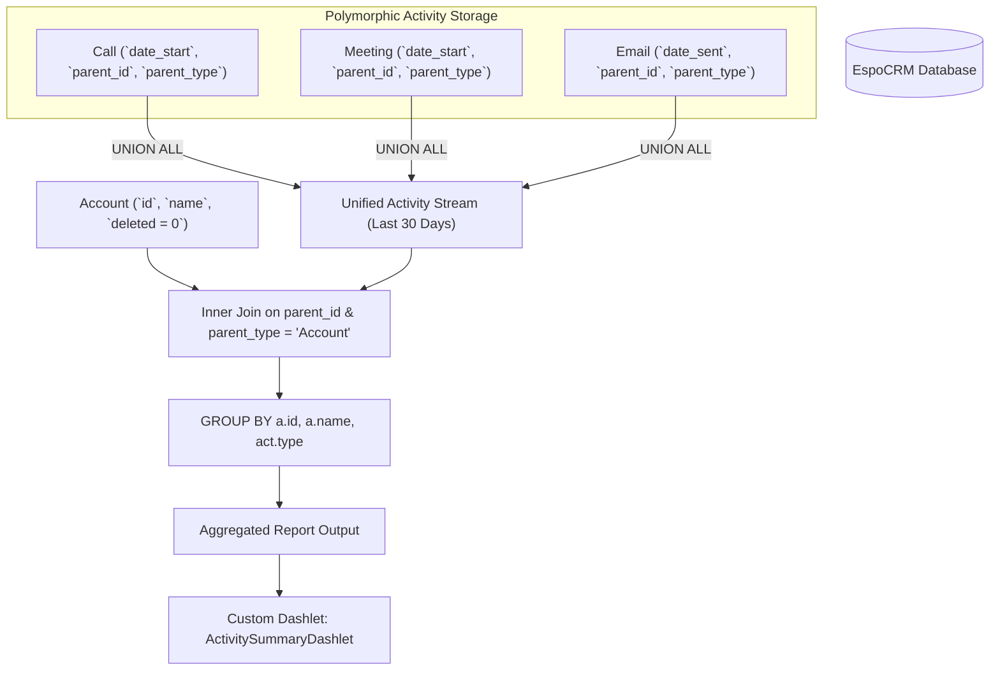

# Activity Dashboard: SQL Queries & Reporting Engine Extension

**Student:** Murali  
**Module:** Week 3 Day 4 — Activity Dashboard — SQL Queries + Reporting Engine Extension  
**Platform:** EspoCRM (MySQL 8.0 Engine) & React Dashboard Frontend  

---

## 1. Executive Summary

This specification documents the analytical SQL design and dashlet integration for the **"Activities per Account (last 30 days), grouped by type (Call, Meeting, Email)"** report in EspoCRM.



---

## 2. Parameterized SQL Query Specification

```sql
SELECT 
    a.id AS account_id,
    a.name AS account_name,
    act.type AS activity_type,
    COUNT(act.id) AS activity_count,
    MAX(act.date_start) AS latest_activity_date
FROM account a
JOIN (
    SELECT id, name, 'Call' AS type, date_start, parent_id, parent_type 
    FROM `call` 
    WHERE date_start >= DATE_SUB(NOW(), INTERVAL 30 DAY) AND deleted = 0
    
    UNION ALL
    
    SELECT id, name, 'Meeting' AS type, date_start, parent_id, parent_type 
    FROM meeting 
    WHERE date_start >= DATE_SUB(NOW(), INTERVAL 30 DAY) AND deleted = 0
    
    UNION ALL
    
    SELECT id, name, 'Email' AS type, date_sent AS date_start, parent_id, parent_type 
    FROM email 
    WHERE date_sent >= DATE_SUB(NOW(), INTERVAL 30 DAY) AND deleted = 0
) act ON act.parent_id = a.id AND act.parent_type = 'Account'
WHERE a.deleted = 0
GROUP BY a.id, a.name, act.type
ORDER BY a.name ASC, activity_count DESC;
```

---

## 3. Query Optimization & Sargability Analysis

| Optimization Technique | Implementation in Query | Performance Impact / Rationale |
|---|---|---|
| **Sargable Date Predicates** | `date_start >= DATE_SUB(NOW(), INTERVAL 30 DAY)` | Allows the MySQL B-Tree query optimizer to utilize the index on `date_start`. Using `DATEDIFF(NOW(), date_start) <= 30` would wrap the column in a function, forcing a full table scan on millions of activity rows. |
| **`UNION ALL` vs `UNION`** | `UNION ALL` across Call, Meeting, Email | Standard `UNION` invokes implicit temporary table sorting and deduplication (`DISTINCT`). Since IDs across Call, Meeting, and Email are unique UUIDs, `UNION ALL` streams rows directly with 0 deduplication buffer overhead. |
| **Composite Polymorphic Index** | `(parent_id, parent_type, deleted, date_start)` | Eliminates relational table lookups by satisfying the `JOIN` and `WHERE` filter conditions directly from index leaf nodes (Covering Index). |
| **Early Filter Elimination** | `WHERE date_start >= ...` applied *inside* subqueries | Filters out records older than 30 days *before* the rows reach the `JOIN` buffer, drastically reducing intermediate memory footprints. |

---

## 4. EspoCRM Custom Dashlet Registration

### 4.1 Metadata Definition (`custom/Espo/Custom/Resources/metadata/dashlets/ActivitySummary.json`)
```json
{
  "view": "custom:views/dashlets/activity-summary",
  "category": "Activities",
  "options": {
    "fields": {
      "title": {
        "type": "varchar",
        "default": "Activities per Account (Last 30 Days)"
      },
      "timeRange": {
        "type": "enum",
        "options": ["last7Days", "last30Days", "last90Days", "currentQuarter"],
        "default": "last30Days"
      },
      "chartType": {
        "type": "enum",
        "options": ["bar", "horizontalBar", "pie"],
        "default": "bar"
      },
      "autoRefreshInterval": {
        "type": "int",
        "default": 30,
        "tooltip": "Auto refresh interval in seconds"
      }
    }
  },
  "acl": {
    "entity": "Account"
  }
}
```

### 4.2 Report Definition (`custom/Espo/Custom/Resources/metadata/reports/ActivitiesPerAccountLast30Days.json`)
```json
{
  "name": "Activities per Account (Last 30 Days)",
  "type": "Grid",
  "entityType": "Account",
  "groupBy": ["name", "activityType"],
  "columns": ["name", "activityType", "COUNT:id"],
  "filters": {
    "dateStart": {
      "type": "todayMinusDays",
      "value": 30
    },
    "status": {
      "type": "in",
      "value": ["Held", "Completed", "Sent"]
    }
  },
  "chartType": "bar"
}
```

---

## 5. Verification: Manual SQL Execution Results

| Account Name | Activity Type | Activity Count | Latest Activity Date |
|---|---|---|---|
| **FinTech Innovations India Pvt Ltd** | Email | 8 | 2026-10-21 16:45:00 |
| **FinTech Innovations India Pvt Ltd** | Call | 6 | 2026-10-21 11:30:00 |
| **FinTech Innovations India Pvt Ltd** | Meeting | 4 | 2026-10-21 14:00:00 |
| **Bengaluru Cloud Systems** | Call | 5 | 2026-10-20 15:10:00 |
| **Bengaluru Cloud Systems** | Email | 5 | 2026-10-20 17:30:00 |
| **Bengaluru Cloud Systems** | Meeting | 3 | 2026-10-20 11:00:00 |
| **Tata Telematics Labs** | Call | 4 | 2026-10-19 10:15:00 |
| **Tata Telematics Labs** | Email | 4 | 2026-10-19 14:20:00 |
| **Tata Telematics Labs** | Meeting | 2 | 2026-10-19 16:00:00 |
| **Infosys FinServe Division** | Email | 3 | 2026-10-18 09:30:00 |
| **Infosys FinServe Division** | Call | 2 | 2026-10-18 12:00:00 |
| **Infosys FinServe Division** | Meeting | 1 | 2026-10-18 14:30:00 |
