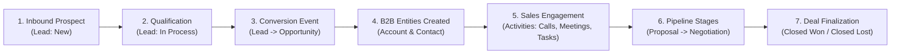

# Enterprise Business Process Mapping: Lead to Closure & API Inspection

**Student:** Murali  
**Module:** Week 3 Day 2 — Business Process Mapping — Lead to Closure + API Inspection  
**Platform:** EspoCRM (Enterprise Architecture) & React Frontend  

---

## 1. Executive Process Architecture

The **Lead-to-Closure** lifecycle represents the core revenue engine in modern B2B Customer Relationship Management (CRM). It tracks an unqualified prospect through qualification, deal negotiation, customer onboarding, and finalized revenue recognition.



---

## 2. Stage-by-Stage Entity & Data Mapping

### Stage 1: Lead Ingestion & Qualification
- **Primary EspoCRM Entity:** `Lead`
- **Business Purpose:** Capture unverified inquiries from web forms, campaigns, or referrals before polluting the verified customer database.
- **Key Fields:**
  - `id`: Unique UUID (`varchar(24)`)
  - `firstName`, `lastName`: Lead contact names (`varchar(100)`)
  - `emailAddress`: Inbound email (`varchar(255)`)
  - `phoneNumber`: Phone number (`varchar(32)`)
  - `accountName`: Unverified company name (`varchar(100)`)
  - `source`: Web Site, Campaign, Referral, Inbound Call (`enum`)
  - `status`: `New`, `Assigned`, `In Process`, `Converted`, `Recycled`, `Dead` (`enum`)
  - `assignedUserId`: Responsible Sales Development Representative (SDR)
- **API Endpoint:**
  - `POST /api/v1/Lead`
  - `GET /api/v1/Lead/{id}`

### Stage 2: Lead Conversion Event
- **Trigger:** Lead meets budget, authority, need, and timeline (BANT) criteria.
- **Atomic Database Operations:**
  1. The `Lead` status updates to `Converted`.
  2. A new `Account` entity is provisioned for the organization.
  3. A new `Contact` entity is created and linked to the Account.
  4. An `Opportunity` entity is initialized with forecasted revenue and closing date.
- **API Endpoint:**
  - `POST /api/v1/Lead/action/convert`

### Stage 3: Opportunity Pipeline & Deal Progression
- **Primary EspoCRM Entity:** `Opportunity`
- **Business Purpose:** Track monetary value, stage velocity, and win probability of an active sales deal.
- **Key Fields:**
  - `name`: Deal title (e.g. *"FinTech Cloud Recruitment Suite"*)
  - `stage`: `Prospecting`, `Qualification`, `Needs Analysis`, `Proposal/Price Quote`, `Negotiation/Review`, `Closed Won`, `Closed Lost`
  - `amount`: Forecasted deal value (`decimal(12,2)`)
  - `currency`: INR / USD
  - `probability`: Win likelihood percentage (0% to 100%)
  - `closeDate`: Target closing date (`date`)
  - `accountId`: Foreign key referencing parent `Account`
  - `contactId`: Primary decision-maker reference
- **API Endpoint:**
  - `GET /api/v1/Opportunity/{id}`
  - `PUT /api/v1/Opportunity/{id}`

### Stage 4: Customer Hierarchy (Account & Contact)
- **Entities:** `Account` (Organization) and `Contact` (Individual Person).
- **Relationship:** One-to-Many (`Account` hasMany `Contacts`; `Account` hasMany `Opportunities`).
- **Key Fields:**
  - `Account.type`: Customer, Partner, Reseller, Investor
  - `Account.industry`: Financial Services, Technology, Healthcare, Manufacturing
  - `Contact.title`: Job title (e.g. *Chief Technology Officer*, *VP of Engineering*)
  - `Contact.accountId`: Parent Account association
- **API Endpoints:**
  - `GET /api/v1/Account/{id}`
  - `GET /api/v1/Contact/{id}`

### Stage 5: Follow-up Engagement & Activity Logging
- **Entities:** `Call`, `Meeting`, `Task`, and `Stream` (Notes/Audit log).
- **Business Purpose:** Preserve full audit trails of interactions to ensure multiple team members can collaborate without duplicate communication.
- **Key Fields:**
  - `Meeting.name`: Interaction objective (e.g. *"Technical Demo & Security Review"*)
  - `Meeting.dateStart`: ISO 8601 timestamp
  - `Meeting.status`: `Planned`, `Held`, `Not Held`
  - `Meeting.parentType` & `parentId`: Polymorphic link pointing to `Opportunity`, `Lead`, or `Account`
- **API Endpoints:**
  - `POST /api/v1/Meeting`
  - `GET /api/v1/Meeting?parentType=Opportunity&parentId={id}`

### Stage 6: Deal Closure & Revenue Recognition
- **Primary Entity State:** `Opportunity.stage = 'Closed Won'`
- **Validation Rules:**
  - Amount must be greater than 0.
  - Close Date must be recorded.
  - Won Probability is locked to 100%.
  - Follow-up onboarding tasks are automatically dispatched via Workflow/BPM.

---

## 3. End-to-End API Sequence Diagram

```mermaid
sequenceDiagram
    autonumber
    actor SDR as Sales Representative
    participant Client as Frontend / React Portal
    participant API as EspoCRM REST API (/api/v1/)
    participant LeadSvc as LeadService
    participant ORM as EntityManager
    participant DB as MySQL 8.0

    SDR->>Client: Submit Lead Web Form
    Client->>API: POST /api/v1/Lead (name, email, company, source)
    API->>LeadSvc: createEntity(data)
    LeadSvc->>ORM: save(Lead)
    ORM->>DB: INSERT INTO lead (...)
    DB-->>API: HTTP 201 Created (id: lead_01)
    API-->>Client: Lead Created

    Note over SDR,Client: Qualification complete (BANT Verified)

    SDR->>Client: Click "Convert Lead"
    Client->>API: POST /api/v1/Lead/action/convert (leadId, createAccount: true, createOpp: true)
    API->>LeadSvc: convertLead(id)
    LeadSvc->>ORM: create Account, Contact, Opportunity
    ORM->>DB: Transaction: INSERT account, contact, opp; UPDATE lead.status='Converted'
    DB-->>API: HTTP 200 OK (accountId, contactId, opportunityId)
    API-->>Client: Conversion Confirmation

    Note over SDR,Client: Technical Review & Engagement

    SDR->>Client: Log Discovery Meeting
    Client->>API: POST /api/v1/Meeting (name, parentType: Opportunity, parentId, status: Held)
    API->>ORM: save(Meeting)
    ORM->>DB: INSERT INTO meeting (...)
    DB-->>API: HTTP 201 Created

    Note over SDR,Client: Negotiation Completed

    SDR->>Client: Move Stage to "Closed Won"
    Client->>API: PUT /api/v1/Opportunity/opp_01 (stage: Closed Won, probability: 100)
    API->>ORM: save(Opportunity)
    ORM->>DB: UPDATE opportunity SET stage='Closed Won', probability=100 WHERE id='opp_01'
    DB-->>API: HTTP 200 OK
    API-->>Client: Deal Won Notification
```

---

## 4. REST API Contracts & Inspection Specifications

### 4.1 Ingest Lead Endpoint
- **Request:** `POST /api/v1/Lead`
- **Headers:**
  - `Content-Type: application/json`
  - `Authorization: Bearer <token>`
- **Payload:**
```json
{
  "firstName": "Kavita",
  "lastName": "Nambiar",
  "accountName": "FinTech Innovations India Pvt Ltd",
  "emailAddress": "kavita.nambiar@fintechinnovations.in",
  "phoneNumber": "+91-98765-43210",
  "source": "Web Site",
  "status": "New",
  "description": "Looking for automated engineering recruitment pipeline and ATS integration."
}
```
- **Response (201 Created):**
```json
{
  "id": "67160a2b918f4a12",
  "name": "Kavita Nambiar",
  "accountName": "FinTech Innovations India Pvt Ltd",
  "status": "New",
  "createdAt": "2026-10-21 10:30:00"
}
```

### 4.2 Lead Conversion Endpoint
- **Request:** `POST /api/v1/Lead/action/convert`
- **Payload:**
```json
{
  "id": "67160a2b918f4a12",
  "records": {
    "Account": { "name": "FinTech Innovations India Pvt Ltd", "industry": "Financial Services" },
    "Contact": { "title": "Chief Technology Officer", "emailAddress": "kavita.nambiar@fintechinnovations.in" },
    "Opportunity": {
      "name": "FinTech Recruitment Suite Expansion",
      "amount": 1250000,
      "stage": "Proposal/Price Quote",
      "probability": 75,
      "closeDate": "2026-11-15"
    }
  }
}
```
- **Response (200 OK):**
```json
{
  "success": true,
  "leadId": "67160a2b918f4a12",
  "accountId": "acc_8923b71f",
  "contactId": "cnt_91823a0c",
  "opportunityId": "opp_49102c8e"
}
```

### 4.3 Log Activity (Meeting) Endpoint
- **Request:** `POST /api/v1/Meeting`
- **Payload:**
```json
{
  "name": "Platform Architecture Demo & Security Compliance",
  "status": "Held",
  "parentType": "Opportunity",
  "parentId": "opp_49102c8e",
  "dateStart": "2026-10-21 14:00:00",
  "dateEnd": "2026-10-21 15:00:00",
  "duration": 3600,
  "description": "Reviewed SOC2 compliance, role-based access control, and ATS API integration. Client approved proposal."
}
```
- **Response (201 Created):**
```json
{
  "id": "meet_582910fa",
  "name": "Platform Architecture Demo & Security Compliance",
  "status": "Held",
  "parentId": "opp_49102c8e"
}
```

### 4.4 Mark Deal Closed Won Endpoint
- **Request:** `PUT /api/v1/Opportunity/opp_49102c8e`
- **Payload:**
```json
{
  "stage": "Closed Won",
  "probability": 100,
  "closeDate": "2026-10-21"
}
```
- **Response (200 OK):**
```json
{
  "id": "opp_49102c8e",
  "name": "FinTech Recruitment Suite Expansion",
  "stage": "Closed Won",
  "probability": 100,
  "amount": 1250000,
  "modifiedAt": "2026-10-21 16:45:00"
}
```

---

## 5. Architectural Conclusions
1. **Data Normalization:** Separating unverified prospects (`Lead`) from established business entities (`Account`, `Contact`, `Opportunity`) maintains high data integrity in ERP/CRM systems.
2. **Polymorphic Associations:** EspoCRM's `parentType` and `parentId` schema enables activities (`Meeting`, `Call`, `Task`) to attach flexibly to any CRM entity without relational explosion.
3. **Decoupled API Contract:** The standard `/api/v1/` REST interface allows modern frontends (e.g. React functional components) to execute transactional workflows with predictable JSON semantics.
