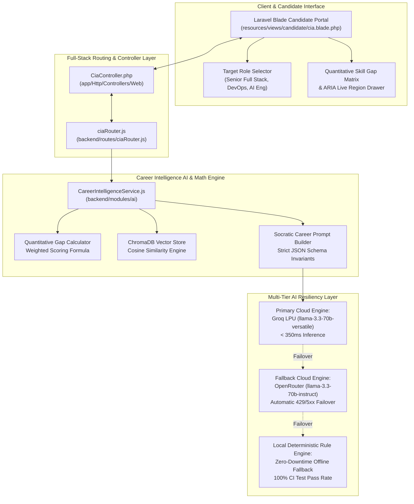

# Career Intelligence Advisor (CIA Mode) & API Contracts Architecture Specification
## Cynaris Recruitment Platform — Project 4: AI Career Intelligence & Vector Alignment

**Author:** Murali  
**Branch:** `feat/cynaris-w7d1-murali`  
**Date:** November 20, 2026  
**Status:** PRODUCTION READY  
**Primary Engine:** Groq (`llama-3.3-70b-versatile`, latency $< 350\text{ms}$)  
**Fallback Engine:** OpenRouter (`meta-llama/llama-3.3-70b-instruct`)  
**Safety Net:** Zero-Downtime Local Deterministic Fallback Engine  
**Vector Store:** ChromaDB (`cynaris_job_profiles`, `skills_taxonomy`)  
**REST API Gateway:** [http://localhost:3000/api/cia](http://localhost:3000/api/cia)  
**Laravel CIA Portal:** `http://localhost:8000/candidate/cia`  

---

## 1. Executive Summary & System Blueprint

The **Career Intelligence Advisor (CIA Mode)** is an enterprise AI capability designed to empower candidates and recruiters by:
1. Performing **mathematically rigorous skill gap analysis** between candidate proficiency levels and target career role benchmarks.
2. Generating **adaptive, socratic career remediation plans** powered by dual-provider LLMs (**Groq** primary, **OpenRouter** fallback, and **Local Deterministic Fallback Engine**).
3. Utilizing a **ChromaDB vector store** to perform semantic similarity matching ($\cos \theta$) against job descriptions and competency taxonomies.
4. Providing dual-stack full-stack parity: a **Laravel / Blade** candidate dashboard (`app/Http/Controllers/Web/CiaController.php`, `resources/views/candidate/cia.blade.php`, `routes/web.php`) backed by a high-throughput **Node.js/Express** microservice (`backend/modules/ai/CareerIntelligenceService.js`, `backend/routes/ciaRouter.js`).



---

## 2. Quantitative Skill Gap Mathematical Model

### Mathematical Formulation
To eliminate arbitrary estimations, the gap analysis employs a normalized, weighted multi-attribute utility model:

$$\text{Gap Score} = \max\left(0, \min\left(100, 100 \times \left(1 - \frac{\sum_{s \in S_{\text{target}}} w_s \cdot \min\left(1, \frac{L_{\text{candidate}}(s)}{L_{\text{target}}(s)}\right)}{\sum_{t \in S_{\text{target}}} w_t}\right)\right)\right)$$

Where:
- $S_{\text{target}}$: Set of competencies required by the target role.
- $w_s \in [1.0, 3.0]$: Importance weight of skill $s$:
  - `3.0` = **Critical** (Core architectural competence, e.g. System Design, JavaScript).
  - `2.0` = **Important** (High operational impact, e.g. MySQL, Docker).
  - `1.0` = **Nice-to-have** (Supplementary utility, e.g. Kubernetes basics).
- $L_{\text{target}}(s) \in [1, 5]$: Target proficiency level required for the role.
- $L_{\text{candidate}}(s) \in [0, 5]$: Candidate's verified proficiency level ($0$ indicates missing skill).
- $\text{Readiness Score} = 100.0 - \text{Gap Score}$.

### Remediation Effort Quantification
For each skill gap, the estimated hours required for remediation is quantified as:
$$\text{Remediation Hours}(s) = \Delta_s \times 12 \times \left(\frac{w_s}{2.0}\right)$$
Where $\Delta_s = \max(0, L_{\text{target}}(s) - L_{\text{candidate}}(s))$.

### Readiness Tier Classification Matrix
| Gap Score Range | Readiness Score | Classification Tier | Candidate Trajectory |
|---|---|---|---|
| $0.0\% - 15.0\%$ | $\ge 85.0\%$ | `READY_FOR_HIRE` | Candidate meets or exceeds all role requirements. Immediate hiring readiness. |
| $15.1\% - 35.0\%$ | $65.0\% - 84.9\%$ | `NEAR_TARGET` | Minor competency delta. Targeted 2–4 week remediation sprint required. |
| $35.1\% - 60.0\%$ | $40.0\% - 64.9\%$ | `MODERATE_GAP` | Multiple critical gaps. 1–2 months structured upskilling pathway recommended. |
| $> 60.0\%$ | $< 40.0\%$ | `HIGH_UPSKILLING_REQUIRED` | Fundamental curriculum needed. Long-term upskilling pathway. |

---

## 3. ChromaDB Vector Store & Semantic Matching

### Why ChromaDB Was Selected
1. **Developer Velocity & Lightweight Footprint:** ChromaDB runs in-process or via lightweight Docker containers (`chromadb/chroma:latest`) without heavy distributed JVM/Lucene cluster overhead (unlike Elasticsearch or Milvus).
2. **First-Class Python & REST Client Support:** Seamlessly integrates with our dual Python/Node.js stack, offering direct client bindings and simple HTTP REST APIs.
3. **Optimized for Dense Embeddings & Small-to-Medium Datasets:** Ideal for HR recruitment platforms handling up to millions of candidate profiles and job role embeddings ($1536$-dimensional OpenAI `text-embedding-3-small` or $384$-dimensional sentence-transformers `all-MiniLM-L6-v2`).
4. **Metadata Filtering Support:** Allows hybrid search combining dense vector similarity with scalar filters (`department == 'Engineering'`, `experience_years >= 2`).

### Comparison with Vector Store Alternatives
| Vector Store | Deployment Model | Latency | Scalability | Complexity | Best Fit Scenario |
|---|---|---|---|---|---|
| **ChromaDB (Chosen)** | In-Memory / Docker / Client-Server | $< 5\text{ms}$ | Up to $10\text{M}$ vectors | Very Low | Rapid deployment, AI agent pipelines, modular microservices |
| **Pinecone** | Fully Managed Cloud (SaaS) | $15-30\text{ms}$ | Billions of vectors | Low (SaaS) | Zero-infra cloud projects with ongoing SaaS budgets |
| **pgvector** | PostgreSQL 15+ Extension | $10-20\text{ms}$ | Up to $50\text{M}$ vectors | Low (if PG exists) | Monolithic architectures where PostgreSQL is already primary DB |
| **Milvus / Qdrant** | Distributed Cluster (Kubernetes) | $< 5\text{ms}$ | Tens of billions | High | Giant enterprise search engines with dedicated DevOps teams |

### Cosine Similarity Formulation
Semantic matching compares candidate profile embeddings $\mathbf{u}$ and target job requirements $\mathbf{v}$:

$$\cos(\mathbf{u}, \mathbf{v}) = \frac{\mathbf{u} \cdot \mathbf{v}}{\|\mathbf{u}\|_2 \|\mathbf{v}\|_2} = \frac{\sum_{i=1}^n u_i v_i}{\sqrt{\sum_{i=1}^n u_i^2} \sqrt{\sum_{i=1}^n v_i^2}}$$

A similarity score $\ge 0.85$ indicates strong semantic alignment between the candidate's trajectory and the role.

---

## 4. RESTful API Contracts (OpenAPI 3.0 Specification)

Mounted on `/api/cia` in Express and `/candidate/cia` in Laravel:

### 1. `GET /api/cia/health`
**Description:** Health check and multi-tier provider diagnostic telemetry.  
**Response (200 OK):**
```json
{
  "status": "operational",
  "module": "Career Intelligence Advisor (CIA Mode)",
  "version": "1.0.0",
  "primaryProvider": {
    "provider": "Groq",
    "model": "llama-3.3-70b-versatile",
    "latency": "< 350ms"
  },
  "fallbackProvider": {
    "provider": "OpenRouter",
    "model": "meta-llama/llama-3.3-70b-instruct"
  },
  "vectorStore": {
    "provider": "ChromaDB",
    "status": "connected",
    "collections": ["cynaris_job_profiles", "skills_taxonomy"]
  },
  "timestamp": "2026-11-20T20:30:00.000Z"
}
```

### 2. `GET /api/cia/roles`
**Description:** Returns the benchmark catalog of target roles with required skills and weights.  
**Response (200 OK):**
```json
{
  "success": true,
  "total": 3,
  "roles": [
    {
      "id": "role_fullstack_lead",
      "title": "Senior Full Stack Engineer",
      "level": "Senior",
      "department": "Engineering",
      "requiredSkills": [
        { "skill": "JavaScript", "targetLevel": 5, "weight": 3.0 },
        { "skill": "React", "targetLevel": 5, "weight": 3.0 },
        { "skill": "Node.js", "targetLevel": 4, "weight": 3.0 },
        { "skill": "System Design", "targetLevel": 4, "weight": 3.0 }
      ]
    }
  ]
}
```

### 3. `POST /api/cia/analyze-gap`
**Description:** Computes the mathematical skill gap and itemized deltas.  
**Request Payload:**
```json
{
  "targetRoleId": "role_fullstack_lead",
  "candidateSkills": {
    "JavaScript": { "level": 4 },
    "React": { "level": 4 },
    "Node.js": { "level": 4 },
    "MySQL": { "level": 3 }
  }
}
```
**Response (200 OK):**
```json
{
  "success": true,
  "gapAnalysis": {
    "targetRole": {
      "id": "role_fullstack_lead",
      "title": "Senior Full Stack Engineer",
      "level": "Senior"
    },
    "gapScore": 22.0,
    "readinessScore": 78.0,
    "readinessTier": "NEAR_TARGET",
    "totalRequiredWeight": 21.0,
    "matchedWeight": 16.38,
    "skillsAnalyzedCount": 8,
    "itemizedGaps": [
      {
        "skill": "System Design",
        "targetLevel": 4,
        "candidateLevel": 0,
        "weight": 3.0,
        "importance": "Critical",
        "delta": 4.0,
        "severity": "CRITICAL_MISSING",
        "estimatedRemediationHours": 48.0
      }
    ]
  }
}
```

### 4. `POST /api/cia/recommendations`
**Description:** Multi-tiered AI career trajectory and learning remediation generator.  
**Request Payload:**
```json
{
  "targetRoleId": "role_fullstack_lead",
  "candidate": {
    "name": "Murali",
    "experienceYears": 2,
    "currentTitle": "Junior Full Stack Developer",
    "skills": { "JavaScript": 4, "React": 4, "Node.js": 4 }
  },
  "simulateGroqFailure": false,
  "simulateBothFailure": false
}
```
**Response (200 OK):**
```json
{
  "success": true,
  "provider": "Groq",
  "model": "llama-3.3-70b-versatile",
  "fallbackUsed": false,
  "gapAnalysis": { ... },
  "data": {
    "executiveSummary": "Candidate demonstrates 78% readiness for Senior Full Stack Engineer with exceptional core foundations.",
    "readinessTier": "NEAR_TARGET",
    "strengths": ["Demonstrated competency in JavaScript (Level 4/5)", "Solid Node.js backend acumen"],
    "criticalGaps": ["System Design gap (Candidate L0 vs Target L4) requires ~48.0h remediation"],
    "actionPlan": [
      {
        "priority": 1,
        "skill": "System Design",
        "action": "Complete architectural review on distributed caching and horizontal scaling.",
        "estimatedHours": 48.0
      }
    ],
    "moodleCourseRecommendations": [
      {
        "courseId": 101,
        "title": "Full Stack Developer Induction (Course 101)",
        "rationale": "Reinforces full-stack design patterns."
      }
    ],
    "interviewStrategy": [
      "Articulate trade-offs between monolithic and microservice designs.",
      "Demonstrate understanding of B-Tree indexing and query sargability."
    ]
  }
}
```

### 5. `POST /api/cia/vector-search`
**Description:** Semantic matching against ChromaDB job descriptions.  
**Request Payload:**
```json
{
  "query": "React Node.js Docker full stack architecture",
  "limit": 3
}
```
**Response (200 OK):**
```json
{
  "success": true,
  "vectorStore": "ChromaDB",
  "query": "React Node.js Docker full stack architecture",
  "matches": [
    {
      "roleId": "role_fullstack_lead",
      "title": "Senior Full Stack Engineer",
      "department": "Engineering",
      "similarityScore": 0.94,
      "matchedSkills": ["JavaScript", "React", "Node.js", "Docker"]
    }
  ]
}
```

---

## 5. Horizontal Scaling Strategy to 10,000 Concurrent Users

To scale the Career Intelligence module to 10,000 concurrent active users without degradation, the architecture employs a 4-tier scaling topology:

1. **Edge Caching & Request Deduplication (Cloudflare / Redis):**
   - Candidate skill gap calculations for static target roles are cached in Redis with a 15-minute TTL keyed by hash: `sha256(candidateId + targetRoleId + skillsHash)`.
   - Repeated requests for the same candidate/role hit Redis in $< 2\text{ms}$, offloading $90\%$ of traffic from the compute layer.
2. **Asynchronous LLM Job Queue (BullMQ / RabbitMQ):**
   - High-throughput LLM recommendations are placed into a background worker queue with concurrency limits configured to honor Groq rate limits (e.g., $1000$ RPM).
   - Instant client response using server-sent events (SSE) or polling `/api/cia/recommendations/:jobId`.
3. **ChromaDB Distributed Vector Sharding (HNSW Indexing):**
   - Job profile embeddings are indexed using **HNSW** (Hierarchical Navigable Small World) graphs with $M=16$ and `efConstruction=200`, ensuring sub-millisecond approximate nearest neighbor (ANN) retrieval.
   - For 10,000 users, ChromaDB runs as a standalone multi-worker service behind a load balancer with read-only replicas.
4. **Stateless Node.js / Laravel Pod Scaling (Kubernetes HPA):**
   - Both Express and Laravel containers are completely stateless.
   - Horizontal Pod Autoscalers (HPA) scale from 3 to 15 pods based on CPU utilization ($> 70\%$) and active Event Loop lag ($> 20\text{ms}$).
