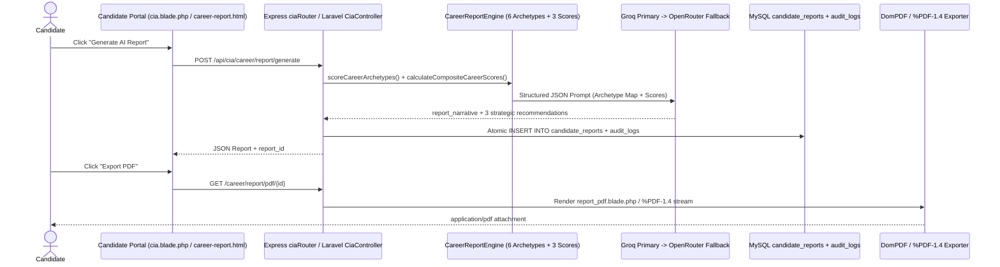

# Career Intelligence Report — Archetype Map + Employability Score Architecture

**Week 8 Day 3 — Cynaris Career Intelligence Platform**  
**Database Table:** `candidate_reports` (MySQL 8.0 + In-Memory Fallback)  
**PDF Engine:** `barryvdh/laravel-dompdf` (`dompdf/dompdf`) + Express `%PDF-1.4` Generator

---

## 1. Six Career Archetypes & 10-Trait Matrix

Each Career Archetype is modeled as a 10-dimensional vector scored `0–10` across:
`system_architecture`, `hands_on_execution`, `analytical_rigor`, `strategic_leadership`, `cross_team_communication`, `creative_experimentation`, `domain_depth`, `cross_functional_adaptability`, `ai_tooling_fluency`, and `quality_reliability_focus`.

| Archetype | Core Strength | Best-Fit Roles |
|---|---|---|
| **Builder** | High `hands_on_execution` (9.6), `quality_reliability_focus` (8.9) | Full Stack Engineer, Product Engineer |
| **Analyst** | High `analytical_rigor` (9.7), `quality_reliability_focus` (9.2) | Data Engineer, Database Performance Engineer |
| **Leader** | High `strategic_leadership` (9.6), `cross_team_communication` (9.5) | Engineering Lead, Solutions Architect |
| **Innovator** | High `creative_experimentation` (9.7), `ai_tooling_fluency` (9.6) | AI Systems Engineer, Applied LLM Engineer |
| **Specialist** | High `domain_depth` (9.8), `quality_reliability_focus` (9.3) | DevOps/Security Specialist, Core Infra Engineer |
| **Generalist** | High `cross_functional_adaptability` (9.6), `cross_team_communication` (8.7) | Founding Engineer, Full Stack Generalist |

---

## 2. Composite Scoring & Archetype Matching Formulas

- **Archetype Match Score (0–100%):** Combines cosine similarity (`65%`) and inverse Euclidean proximity (`35%`) between the intern's derived 10-trait vector (from skill scores, learning style, and project performance) and each archetype's 10-trait profile.
- **Employability Score (0–100):** `0.40 * skill_completeness + 0.35 * project_quality + 0.25 * assessment_scores`
- **AI Readiness Score (0–100):** `0.60 * min(100, (ai_tasks_completed / 10) * 100) + 0.40 * min(100, (ai_tools_count / 6) * 100)`
- **Placement Readiness Score (0–100):** Reuses Module 6 (`0.40 * project_completion + 0.30 * assessment + 0.10 * cia_normalized + 0.20 * documentation`).

---

## 3. Dual-Provider AI & Persistence Flow

