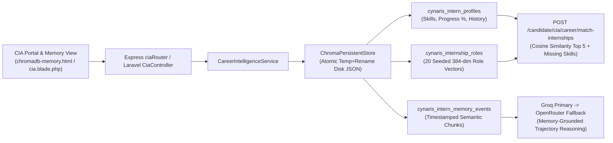

# CIA Memory Layer — ChromaDB Persistent Intern Profile

**Week 8 Day 4 — Cynaris Career Intelligence Platform**  
**Collections:** `cynaris_intern_profiles`, `cynaris_intern_memory_events`, `cynaris_internship_roles` (20 roles)  
**Embedding Model:** `sentence-transformers/all-MiniLM-L6-v2` (384-dimensional L2-normalized vectors)

---

## 1. Architecture Overview

The CIA Memory Layer upgrades ChromaDB from ephemeral in-memory maps to an **atomic disk-backed persistent vector store** ([`ChromaPersistentStore.js`](../backend/modules/ai/ChromaPersistentStore.js)) persisted at `backend/data/chromadb_store.json`.

---

## 2. Key Capabilities

1. **Persistent Intern Profile (`cynaris_intern_profiles`)**: Retains verified skills, progress %, completed modules, assessments, and rolling interaction history across restarts.
2. **20 Seeded Internship Roles (`cynaris_internship_roles`)**: Auto-embedded into 384-dim unit vectors on first access and persisted in ChromaDB.
3. **Memory-Aware Internship Matching (`POST /candidate/cia/career/match-internships`)**: Embeds candidate skills (recalling them from `cynaris_intern_profiles` if omitted), runs cosine similarity + skill ratio ranking, returns Top 5 matches with `matchPercentage` and `missingSkills`, and logs the match event into `cynaris_intern_memory_events`.
4. **Semantic Memory Reasoning (`POST /api/cia/memory/query`)**: Retrieves top-$k$ cosine-similar memory events for the candidate and synthesizes next-step guidance via Groq (`llama-3.3-70b-versatile`) with OpenRouter fallback.
