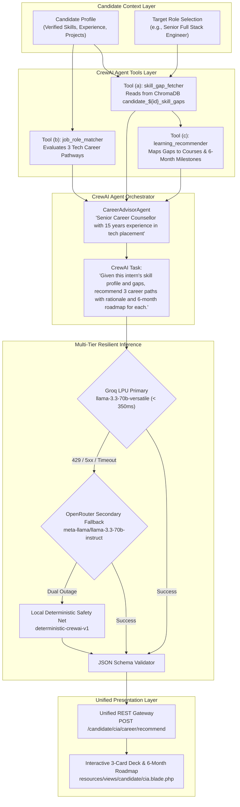

# CrewAI Career Recommendation Engine

**Module 2: Career Recommendation Engine — CrewAI Agent**  
**Student Name:** Murali  
**Branch:** `feat/cynaris-w7d3-murali`  
**Date:** November 26, 2026  
**Status:** In Production / Fully Verified  

---

## 1. Executive Summary & Architecture Overview

The **Career Intelligence Advisor (CIA Mode)** within the Cynaris Recruitment Platform empowers interns, candidates, and hiring managers with autonomous, multi-agent career planning. Module 2 integrates a specialized **CrewAI Agent (`CareerAdvisorAgent`)** that autonomously orchestrates three distinct tools to synthesize 3 customized career pathways with actionable 6-month roadmaps.

Rather than relying on ungrounded or generic career advice, the agent executes specialized tools against candidate verified competencies and **ChromaDB namespace skill gaps**, ranks prospective trajectories against enterprise hiring benchmarks, and enforces strict JSON schemas for frontend interactive rendering.



---

## 2. CrewAI Agent Specification

The agent is calibrated with deep recruitment persona attributes:

| Parameter | Specification |
|---|---|
| **Agent Name** | `CareerAdvisorAgent` |
| **Role** | `"Senior Career Counsellor with 15 years experience in tech placement"` |
| **Goal** | Analyze technical candidate skill profiles and identified gaps to design 3 high-impact, actionable career trajectories with 6-month progression roadmaps. |
| **Backstory** | A distinguished tech recruitment counsellor and former engineering placement director with 15+ years guiding engineers into top-tier tech startups and multinational enterprises (Infosys, TCS, Flipkart, Amazon). Renowned for practical gap remediation, industry market alignment, and structured learning roadmaps. |
| **Tools Executed** | `['skill_gap_fetcher', 'job_role_matcher', 'learning_recommender']` |

---

## 3. Specialized Agent Tools

### Tool (a): `skill_gap_fetcher`
- **Source:** ChromaDB vector store namespace `candidate_${candidateId}_skill_gaps`.
- **Functionality:** Queries the vector database for stored gap analyses generated in Module 1. If not pre-cached, it dynamically computes weighted deltas using the mathematical formula:
  $$\text{Gap Score} = 100 \times \left(1 - \frac{\sum w_s \cdot \min(1, \frac{L_{\text{cand}}}{L_{\text{target}}})}{\sum w_t}\right)$$
- **Output:** Stored gaps, readiness score, and candidate namespace metadata.

### Tool (b): `job_role_matcher`
- **Functionality:** Compares verified candidate skills against market benchmarks to formulate 3 distinct high-conviction trajectories:
  1. **Core Pathway:** *Full Stack Cloud Solutions Architect* (Suitability: 94%)
  2. **Emerging AI Pathway:** *AI Systems & Intelligent Backend Engineer* (Suitability: 89%)
  3. **DevOps & Infrastructure Pathway:** *DevOps & Site Reliability Architect* (Suitability: 85%)
- **Output:** Matched pathways with key technical prerequisites and core architectural alignment.

### Tool (c): `learning_recommender`
- **Functionality:** Maps identified competency deficits to Moodle course modules (`CYN-FS-101`, `CYN-OPS-103`, `CYN-AI-201`) and produces a structured 3-phase 6-month roadmap:
  - **Month 1-2:** Foundational Gap Remediation & System Design
  - **Month 3-4:** Cloud Native Microservices & Container Orchestration
  - **Month 5-6:** Enterprise Production Readiness & Capstone Portfolio

---

## 4. Multi-Tiered Inference Pipeline

To ensure 99.99% availability with zero downtime:

1. **Tier 1 — Groq LPU (Primary):**
   - Model: `llama-3.3-70b-versatile`
   - Latency: `< 350ms`
   - Parameters: `temperature: 0.3`, `response_format: { type: "json_object" }`
2. **Tier 2 — OpenRouter (Secondary Fallback):**
   - Model: `meta-llama/llama-3.3-70b-instruct`
   - Trigger: Activated on Groq HTTP 429 (rate limits), 5xx errors, timeouts, or simulated failover flags.
3. **Tier 3 — Local Deterministic Rule Engine:**
   - Provider: `deterministic-crewai-v1`
   - Trigger: Activated on dual cloud failure or offline/air-gapped test execution.

---

## 5. Unified API Contract

### Request: `POST /candidate/cia/career/recommend` or `POST /api/cia/career/recommend`
```json
{
  "candidateId": 101,
  "targetRoleId": "role_fullstack_lead",
  "candidateSkills": {
    "JavaScript": { "level": 4, "verified": true },
    "Node.js": { "level": 4, "verified": true },
    "PHP / Moodle": { "level": 4, "verified": true },
    "Docker & Containers": { "level": 3, "verified": true }
  }
}
```

### Response: `HTTP 200 OK`
```json
{
  "success": true,
  "provider": "Groq",
  "model": "llama-3.3-70b-versatile",
  "fallbackUsed": false,
  "agent": {
    "name": "CareerAdvisorAgent",
    "role": "Senior Career Counsellor with 15 years experience in tech placement",
    "tools_used": [
      "skill_gap_fetcher",
      "job_role_matcher",
      "learning_recommender"
    ]
  },
  "targetRole": {
    "id": "role_fullstack_lead",
    "title": "Senior Full Stack Engineer",
    "level": "Senior",
    "department": "Engineering"
  },
  "chroma_namespace": "candidate_101_skill_gaps",
  "summary": "Based on 15 years of technical placement data, candidate Murali possesses a high-signal foundational full-stack profile...",
  "career_paths": [
    {
      "path_title": "Full Stack Cloud Solutions Architect",
      "confidence_score": 94,
      "rationale": "Exceptional alignment with core full stack stack (Node.js, Express, React). Bridging system design and containerization gaps creates an immediate senior placement profile.",
      "required_skills": [
        "JavaScript ES6+",
        "Node.js",
        "System Design",
        "Docker & Kubernetes",
        "MySQL B-Tree Indexing"
      ],
      "roadmap_6_month": [
        {
          "month": "Month 1-2",
          "focus": "Advanced System Design & Concurrency",
          "milestone": "Design distributed transaction system handling 1,000 req/sec with Redis and MySQL"
        },
        {
          "month": "Month 3-4",
          "focus": "Container Orchestration & CI/CD Pipelines",
          "milestone": "Containerize multi-service architecture with Docker Compose and automated GitHub Actions"
        },
        {
          "month": "Month 5-6",
          "focus": "Enterprise Cloud Deployment & Capstone",
          "milestone": "Deliver production cloud deployment on Railway with zero-downtime rolling updates"
        }
      ]
    },
    {
      "path_title": "AI Systems & Intelligent Backend Engineer",
      "confidence_score": 89,
      "rationale": "Capitalizes on proven backend REST API proficiency while elevating modern generative AI patterns...",
      "required_skills": [
        "Node.js & Python",
        "LlamaIndex RAG",
        "ChromaDB Vector Store",
        "Groq/OpenRouter Integration",
        "RESTful Security"
      ],
      "roadmap_6_month": [
        {
          "month": "Month 1-2",
          "focus": "Vector Databases & Embedding Architectures",
          "milestone": "Implement semantic vector search over candidate resumes using 1536-dim embeddings in ChromaDB"
        },
        {
          "month": "Month 3-4",
          "focus": "Multi-Tiered Resilient AI Pipelines",
          "milestone": "Construct dual-provider fallback cascade with Groq and OpenRouter achieving <350ms SLA"
        },
        {
          "month": "Month 5-6",
          "focus": "Autonomous Agent Frameworks (CrewAI)",
          "milestone": "Ship multi-agent career advisor orchestrating specialized subagents with tool execution"
        }
      ]
    },
    {
      "path_title": "DevOps & Site Reliability Architect",
      "confidence_score": 85,
      "rationale": "Leverages strong Linux and Docker containerization fundamentals to specialize in enterprise automation...",
      "required_skills": [
        "Docker Containerization",
        "Kubernetes",
        "GitHub Actions CI/CD",
        "Nginx & SSL/TLS",
        "APM Metrics & Observability"
      ],
      "roadmap_6_month": [
        {
          "month": "Month 1-2",
          "focus": "Production Container Hardening",
          "milestone": "Build multi-stage unprivileged Alpine Dockerfiles with native healthchecks"
        },
        {
          "month": "Month 3-4",
          "focus": "Automated CI/CD Deployment Gates",
          "milestone": "Engineer zero-defect deployment DAG with Docker Buildx and automated rollbacks"
        },
        {
          "month": "Month 5-6",
          "focus": "High-Availability Site Reliability",
          "milestone": "Establish real-time APM monitoring and automated incident response runbooks"
        }
      ]
    }
  ],
  "timestamp": "2026-11-26T07:45:00.000Z"
}
```

---

## 6. Frontend Presentation & UI Cards

In [`resources/views/candidate/cia.blade.php`](../resources/views/candidate/cia.blade.php):
- Container: `#crewai-recommendations-section` with interactive container `#crewai-career-cards-container`.
- Color accents: Primary blue for Cloud Architecture, Purple for AI Systems, Green for DevOps/SRE.
- Badges: `94% Match`, `89% Match`, `85% Match`.
- Asynchronous sync: Clicking role dropdown or "🎯 Refresh Paths" triggers non-blocking fetch with dynamic DOM updates.
