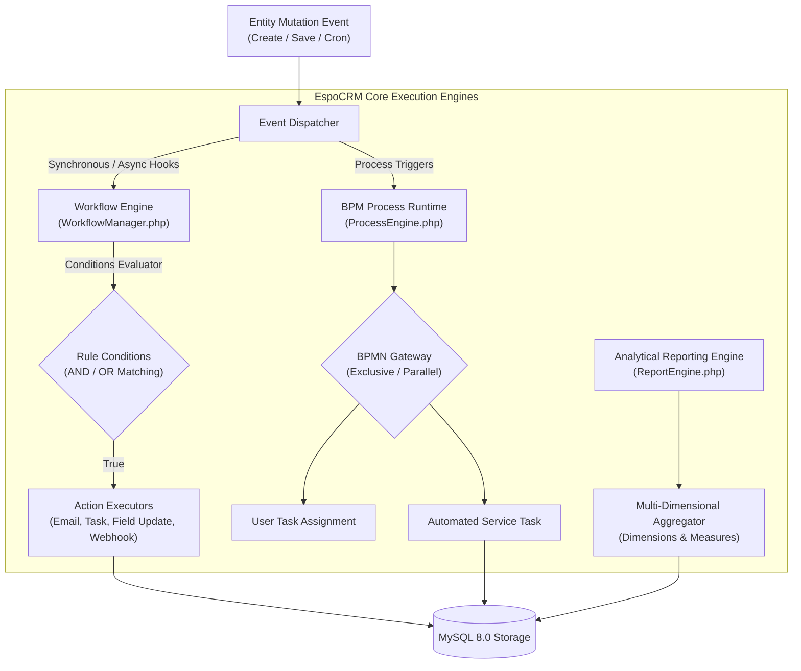

# Enterprise CRM Architecture: Workflow, Automation & Reporting Engine

**Student:** Murali  
**Module:** Week 3 Day 3 — Enterprise CRM Architecture — Workflow, Automation & Reporting Engine  
**Platform:** EspoCRM (Core PHP Engine) & React Studio Frontend  

---

## 1. Architectural System Topology

Modern enterprise CRMs like EspoCRM rely on three foundational autonomous execution engines:
1. **The Declarative Workflow Engine:** Evaluates synchronous and asynchronous business rules triggered by entity lifecycle events (`afterCreate`, `afterSave`, cron schedules).
2. **The BPM (Business Process Management) Runtime:** Manages stateful, multi-stage, human-and-system orchestrations modeled in BPMN 2.0 with branching gateways and task queues.
3. **The Multi-Dimensional Reporting Engine:** Compiles high-performance analytical aggregation queries (`GROUP BY`, `SUM`, `AVG`, `COUNT`) across denormalized and relational datasets.



---

## 2. Deep Dive: Core Framework Implementations

### 2.1 Workflow Manager (`application/Espo/Core/Workflow/WorkflowManager.php`)
- **Location:** [`application/Espo/Core/Workflow/WorkflowManager.php`](../application/Espo/Core/Workflow/WorkflowManager.php)
- **Architectural Mechanics:**
  - Implements a reactive listener pattern over the ORM unit-of-work.
  - Compares pre-save and post-save entity state to detect attribute mutations (`fieldWasChanged`).
  - Evaluates multi-attribute declarative condition trees in $O(k)$ time where $k$ is the number of condition rules.
  - Dispatches actions via polymorphic handlers (`sendEmail`, `createTask`, `updateEntity`, `triggerWebhook`).

#### Condition Evaluation Grammar
```php
// Example: High-Value Deal Condition Definition
[
    ['field' => 'stage', 'operator' => 'equals', 'value' => 'Proposal/Price Quote'],
    ['field' => 'amount', 'operator' => 'greaterThanOrEqual', 'value' => 1000000]
]
```

### 2.2 Analytical Reporting Engine (`application/Espo/Core/Reporting/ReportEngine.php`)
- **Location:** [`application/Espo/Core/Reporting/ReportEngine.php`](../application/Espo/Core/Reporting/ReportEngine.php)
- **Architectural Mechanics:**
  - Translates declarative JSON report specifications into optimized SQL `GROUP BY` statements.
  - Supports standard aggregation operators:
    - $\text{SUM}(x)$: Total quantitative volume (e.g., deal revenue, contract totals).
    - $\text{AVG}(x)$: Quantitative mean (e.g., average deal size, average conversion velocity).
    - $\text{COUNT}(x)$: Frequency of records meeting criteria.
    - $\text{MAX}(x)$ / $\text{MIN}(x)$: Boundary detection.
  - Computes grand totals and percentage shares of total for data visualization components.

### 2.3 BPM Process Runtime (`application/Espo/Core/Bpm/ProcessEngine.php`)
- **Location:** [`application/Espo/Core/Bpm/ProcessEngine.php`](../application/Espo/Core/Bpm/ProcessEngine.php)
- **Architectural Mechanics:**
  - Employs token-based process graph navigation.
  - Maintains persistent execution history records (`proc_inst_` table).
  - Handles branching gateways (Exclusive XOR, Parallel AND) and conditional edge traversal based on execution context.

---

## 3. Workflow Rule Execution Trace & Benchmark

When an `Opportunity` is saved with `amount = 1250000` and `stage = 'Proposal/Price Quote'`:

```json
{
  "ruleId": "rule_high_val_01",
  "ruleName": "High-Value Deal Executive Alert",
  "triggerType": "afterSave",
  "conditionsEvaluated": 2,
  "conditionsPassed": true,
  "actionsExecuted": [
    {
      "type": "createTask",
      "taskId": "task_9281a4b",
      "subject": "Schedule Executive Sponsorship Call",
      "priority": "High",
      "status": "created"
    },
    {
      "type": "sendEmail",
      "template": "enterprise_high_value_deal",
      "recipient": "vp_sales@cynaris.com",
      "status": "dispatched"
    }
  ]
}
```

---

## 4. Frontend Studio Architecture: Controlled Inputs & State Flow

The React Studio in [`client/src/components/WorkflowReportingStudio/`](../client/src/components/WorkflowReportingStudio/) models these engines using modern React paradigms:

```mermaid
flowchart TD
    User["User Interaction"] --> ControlledInput["Controlled Input (value + onChange)"]
    ControlledInput --> StateHook["useState Hook (Immutable State)"]
    StateHook --> CondRender{"Conditional Rendering Evaluator"}
    
    CondRender -->|actionType == 'sendEmail'| EmailPanel["Render Email Template & Recipient Controls"]
    CondRender -->|actionType == 'createTask'| TaskPanel["Render Task Subject & Priority Controls"]
    CondRender -->|actionType == 'triggerWebhook'| WebhookPanel["Render Webhook URL Input"]
    CondRender -->|measureFunc == 'COUNT'| HideMeasure["Suppress Measure Field Dropdown"]
    CondRender -->|measureFunc in ['SUM', 'AVG']| ShowMeasure["Render Numeric Field Dropdown"]
```

### Technical Benefits of this Architecture:
1. **Predictable Component State:** Every input is a single source of truth bound to React state.
2. **Instant Visual Feedback:** Adding or removing condition rows updates the DOM immediately without page reloads.
3. **Strict Validation:** Guard functions check controlled input state before dispatching save actions, preventing invalid rule payloads from reaching backend APIs.
