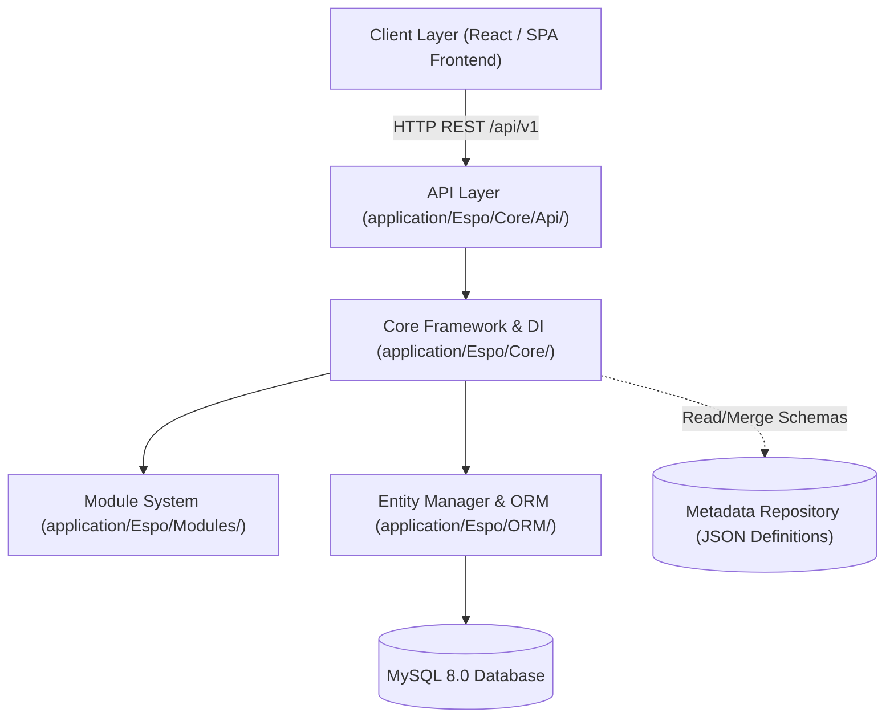

# EspoCRM Architecture & Technical Study

**Student:** Murali  
**Module:** Week 3 Day 1 — Fork, Clone & Local Setup — EspoCRM  
**Topic:** Core Architectural Decisions & Repository Anatomy  

---

## 1. Architectural Overview

EspoCRM is a modern, open-source Single-Page Application (SPA) CRM platform built with an enterprise PHP backend and a responsive frontend client. Unlike traditional monolithic CMS/CRM platforms (such as WordPress or older SugarCRM forks), EspoCRM was engineered from the ground up with a clean separation of concerns between its RESTful backend API and its dynamic frontend interface.



---

## 2. Deep Dive: 4 Core Repository Directories

### 2.1 Core Framework — `application/Espo/Core/`
- **Location:** [`application/Espo/Core/Application.php`](../application/Espo/Core/Application.php), [`Container.php`](../application/Espo/Core/Container.php)
- **Role:** Serves as the system kernel and dependency injection container.
- **Key Responsibilities:**
  - Manages the lifecycle of request handlers, database connection pools, authentication managers, and metadata loaders.
  - Implements PSR-compatible service resolution without tight coupling.
  - Controls application bootstrapping, configuration caching, and system upgrade migrations.

### 2.2 Module System — `application/Espo/Modules/`
- **Location:** [`application/Espo/Modules/Recruitment/Module.php`](../application/Espo/Modules/Recruitment/Module.php)
- **Role:** Implements plug-and-play modular extensions.
- **Key Responsibilities:**
  - Isolates domain packages (e.g. Sales, Marketing, Recruitment) into autonomous directories.
  - Merges module-level metadata (`Resources/metadata/`) seamlessly into the core system metadata.
  - Allows clean installation and uninstallation of business modules without editing core codebase files.

### 2.3 API Layer — `application/Espo/Core/Api/`
- **Location:** [`application/Espo/Core/Api/Request.php`](../application/Espo/Core/Api/Request.php), [`Response.php`](../application/Espo/Core/Api/Response.php)
- **Role:** Standardized RESTful communication gateway.
- **Key Responsibilities:**
  - Translates incoming HTTP verbs (GET, POST, PUT, DELETE, PATCH) into controller actions.
  - Parses query filters (`where`, `select`, `order`, `offset`, `maxSize`).
  - Enforces API authentication (Bearer tokens, API keys) and formats deterministic JSON responses with HTTP status codes.

### 2.4 Entity Manager & ORM — `application/Espo/ORM/`
- **Location:** [`application/Espo/ORM/EntityManager.php`](../application/Espo/ORM/EntityManager.php), [`Entity.php`](../application/Espo/ORM/Entity.php), [`Repository.php`](../application/Espo/ORM/Repository.php)
- **Role:** Custom lightweight Object-Relational Mapping engine.
- **Key Responsibilities:**
  - Manages database entity abstractions and transactional persistence.
  - Executes lifecycle hooks (`beforeSave`, `afterSave`, `beforeDelete`) for business logic execution.
  - Eliminates SQL boilerplate while maintaining maximum query performance and field-level Access Control List (ACL) security.

---

## 3. The 3 Key Architectural Decisions

### Decision 1: Metadata-Driven Architecture (Declarative JSON Configuration)
- **What it is:** Every entity, field type, validation rule, relationship, and UI layout is defined in declarative JSON files under `Resources/metadata/` rather than hardcoded in PHP classes or database schemas.
- **Why it was chosen:**
  1. Allows non-technical administrators to create custom entities and custom fields via the web UI without modifying PHP source code.
  2. Ensures custom changes survive core software updates because metadata is merged hierarchically: `Core Metadata` → `Module Metadata` → `Custom User Metadata`.
  3. Greatly accelerates development: adding a new field to `JobApplicant.json` automatically generates the database column, REST API parameters, validation rules, and frontend form fields.

### Decision 2: Decoupled Single-Page Application (SPA) with Pure REST API
- **What it is:** EspoCRM does not use server-side HTML rendering (like Blade or Twig) for its primary user interface. Instead, the backend exposes a pure JSON REST API (`/api/v1/`), while the frontend is a standalone Single Page Application.
- **Why it was chosen:**
  1. Exceptional user experience: navigation between views, modals, and records occurs instantaneously in the browser without full page reloads.
  2. Multi-channel ready: the same REST API powers the web frontend, mobile applications, external third-party integrations, and headless portals (such as our React Candidate Portal).
  3. High caching efficiency: static assets (JS, CSS, HTML templates) are cached aggressively by CDNs and browsers, requiring the server only to transmit small JSON payloads.

### Decision 3: Custom Lightweight Domain-Specific ORM (Instead of Heavy Third-Party ORMs)
- **What it is:** EspoCRM chose to implement its own custom ORM in `Espo/ORM/` rather than bundling generic enterprise ORMs like Doctrine or Eloquent.
- **Why it was chosen:**
  1. **Dynamic Metadata Integration:** Generic ORMs rely on static PHP annotations or compiled classes. EspoCRM's ORM dynamically parses JSON metadata at runtime, allowing instant schema expansion without compiling code.
  2. **Minimal Memory Footprint & High Throughput:** Doctrine's unit-of-work tracking and identity maps introduce significant overhead in high-concurrency environments. EspoCRM's lightweight repository pattern delivers sub-10ms query times on standard web hosting.
  3. **Native Entity Hook Lifecycle:** Hooks (`beforeSave`, `afterSave`) are directly coupled with EspoCRM's granular Role-Based Access Control (RBAC) and Audit Log streams.

---

## 4. Local Setup & Docker Infrastructure

### 4.1 Container Stack
- **MySQL 8.0:** Default database container with persistent named volume `espocrm-mysql-data`.
- **EspoCRM App:** PHP 8.2 Apache container running on port `8080`.
- **EspoCRM Daemon:** Background process worker for cron jobs and asynchronous notifications.
- **phpMyAdmin:** Web database manager exposed on port `8081`.

### 4.2 Local Run Commands
```bash
# 1. Prepare environment variables
cp .env.espocrm.example .env.espocrm

# 2. Start services in background
docker compose -f docker-compose.espocrm.yml up -d

# 3. View container health and logs
docker compose -f docker-compose.espocrm.yml ps
docker compose -f docker-compose.espocrm.yml logs -f espocrm

# 4. Open in browser:
# Web App:      http://localhost:8080
# Database UI:  http://localhost:8081
```
