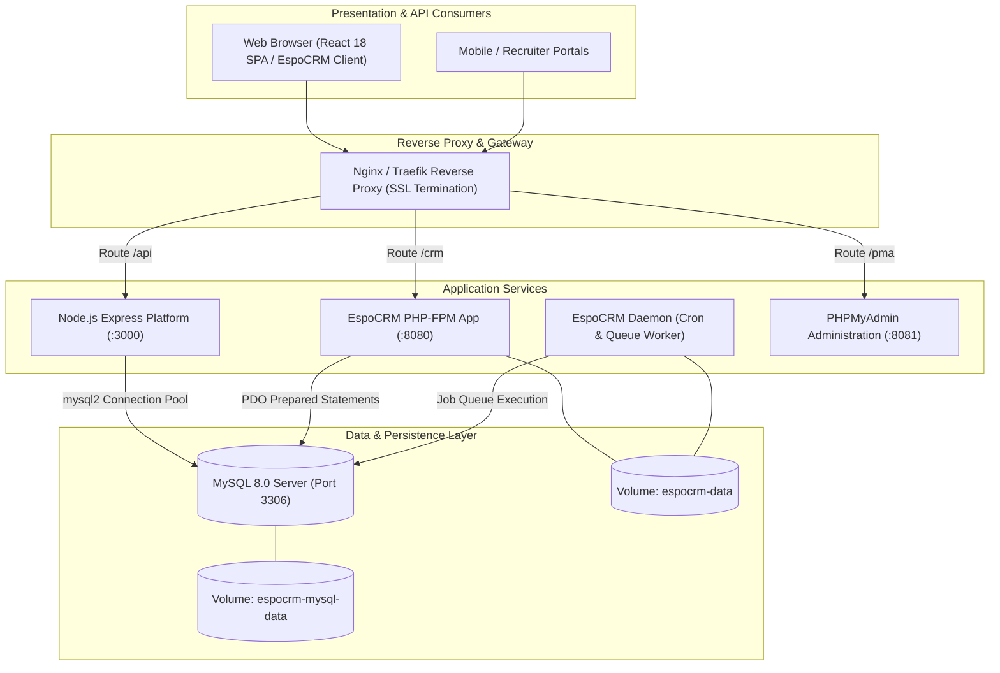

# EspoCRM Production Architecture & Node.js MySQL Integration

**Internship:** Cynaris Solutions Full Stack Development  
**Author:** Murali  
**Branch:** `feat/cynaris-w4d4-murali`  
**Date:** October 31, 2026  
**Module:** Week 4 Day 4 — Deploy EspoCRM Fork to Production & Connect Node.js to MySQL using mysql2  

---

## 1. Executive Summary & Architectural Overview

EspoCRM is an enterprise-grade, open-source Customer Relationship Management (CRM) and Business Process Management (BPM) application built on a modern **PHP 8.2+ backend** and a decoupled **Single-Page Application (SPA) frontend**.

In enterprise recruitment environments like Cynaris Solutions, EspoCRM acts as the central datastore for candidate records, interview pipelines, interaction timelines, and automated workflow triggers. The Node.js microservice layer (`cynaris-recruitment-platform`) interfaces directly with the underlying **MySQL 8.0 database** using `mysql2/promise` connection pooling, executing high-speed prepared statements and orchestrating AI-driven smart reminder dispatches.



---

## 2. Three Key Architectural Decisions Made by EspoCRM

After an exhaustive review of the repository architecture (`application/Espo/Core/`, `application/Espo/ORM/`, `application/Espo/Modules/`), three defining architectural decisions distinguish EspoCRM from legacy PHP applications:

### Decision 1: Metadata-Driven Entity Architecture (Declarative JSON Schemas)
* **Design Philosophy:** Rather than hardcoding database schemas in SQL scripts or binding UI forms directly to relational tables, EspoCRM employs a **purely declarative metadata system**.
* **Implementation Mechanism:** Every entity is defined in JSON files inside `Resources/metadata/entityDefs/<Entity>.json`. This schema specifies:
  - Field types (`varchar`, `enum`, `text`, `int`, `datetime`, `json`).
  - Relation definitions (`hasMany`, `belongsTo`, `hasChildren`).
  - Validation rules (`required`, `readOnly`, `maxLength`).
  - Auditing and stream tracking flags.
* **Architectural Advantage:** When developers or administrators add a custom field (such as `ai_resume_summary` or `pipeline_stage`), EspoCRM dynamically updates the ORM query builder, adjusts REST API serialization, and re-renders the frontend layout without requiring manual schema rewrites or custom template rendering.

### Decision 2: Decoupled Single-Page Application (SPA) with RESTful API-First Backend
* **Design Philosophy:** The backend does not render HTML pages. It functions exclusively as a **stateless RESTful API engine** returning standardized JSON payloads.
* **Implementation Mechanism:**
  - Incoming HTTP requests are intercepted by `application/Espo/Core/Api/Request.php` and routed through the Dependency Injection Container (`Container.php`).
  - The frontend is an independent JavaScript SPA (using Backbone.js/Marionette architecture alongside modern React components) that fetches metadata on initial load and renders views dynamically in the browser DOM.
* **Architectural Advantage:** Extreme performance and separation of concerns. The server spends CPU cycles solely on business logic, validation, and database operations. Furthermore, external microservices (like our Node.js AI Reminders Engine) integrate seamlessly through identical REST contracts.

### Decision 3: Hierarchical Customization Cascade & Non-Destructive Extension
* **Design Philosophy:** Enterprise enterprise software requires deep customization, but upgrades must not overwrite tenant modifications. EspoCRM enforces a **3-tier hierarchical loading cascade**:
  ```text
  Priority 1: custom/Espo/Custom/          (Tenant-specific overrides)
  Priority 2: application/Espo/Modules/     (Packaged feature modules, e.g. Recruitment)
  Priority 3: application/Espo/Core/        (Core base framework)
  ```
* **Implementation Mechanism:** When resolving a controller, entity definition, or hook, EspoCRM checks `custom/` first. If present, it overrides or deeply merges with the core definition.
* **Architectural Advantage:** Zero-downtime upgrades. Core files in `application/Espo/` can be updated via Git or package archives while preserving all custom business logic, custom hooks, and entity extensions intact in `custom/`.

---

## 3. Production Deployment Topology (Docker Compose)

Our production stack is codified in [`docker-compose.espocrm.yml`](../docker-compose.espocrm.yml) with configuration parameterized in [`.env.espocrm.example`](../.env.espocrm.example).

### Container Services & Responsibilities:

| Service Name | Container Image | Port Binding | Key Function & Production Configuration |
|---|---|---|---|
| `espocrm-mysql` | `mysql:8.0` | Internal (3306) | Production database server configured with utf8mb4 encoding, strict SQL mode, InnoDB buffer pool, and healthcheck: `mysqladmin ping -h localhost -u root -p${MYSQL_ROOT_PASSWORD}`. |
| `espocrm` | `espocrm/espocrm:latest` | `8080:80` | Web application running Apache/PHP-FPM, serving the EspoCRM REST API and client-side single page application. |
| `espocrm-daemon` | `espocrm/espocrm:latest` | Background worker | Long-running worker executing `php /var/www/html/daemon.php` to process scheduled jobs, email sync, workflow triggers, and BPM activities. |
| `espocrm-phpmyadmin` | `phpmyadmin/phpmyadmin` | `8081:80` | Web-based database management interface for development and staging DBA inspection. |

### Data Persistence & Volume Isolation:
- `espocrm-mysql-data`: Named persistent volume mapped to `/var/lib/mysql`, protecting relational data across container restarts and redeployments.
- `espocrm-data`: Named volume mapped to `/var/www/html`, persisting user attachments, custom metadata overrides, and cache files.
- `espocrm-network`: Dedicated bridge network isolating database traffic from the host network interface.

---

## 4. Repository Folder Structure Breakdown

```text
cynaris-intership/
├── application/                  # EspoCRM Core Application Source
│   └── Espo/
│       ├── Core/                 # Core framework: Application.php, Container.php, DI registry
│       │   ├── Ai/               # Conversation summarization and LLM services
│       │   ├── Api/              # RESTful API layer: Request.php, Response.php
│       │   ├── Bpm/              # Business Process Management engine
│       │   ├── Reporting/        # Analytical query and report aggregation engine
│       │   └── Workflow/         # Event-driven rule evaluation and action dispatcher
│       ├── Modules/              # Modular extension packages
│       │   └── Recruitment/      # Cynaris recruitment extension module
│       ├── ORM/                  # Object-Relational Mapping layer
│       │   ├── Entity.php        # Entity model data container with dirty-state tracking
│       │   ├── EntityManager.php # Central entity persistence and repository registry
│       │   └── Repository.php    # Entity repository data access abstraction
│       └── Resources/            # Core metadata schemas
│           └── metadata/         # JSON entity definitions (JobApplicant.json)
├── backend/                      # Node.js Microservices Platform
│   ├── database/                 # MySQL Connection Pool & Repository Pattern
│   │   ├── mysqlClient.js        # mysql2 connection pool, prepared statements & fallback
│   │   ├── applicantRepository.js# CRUD operations using prepared statements
│   │   └── schema.sql            # DDL migrations for recruitment & reminders tables
│   ├── modules/                  # Business domains (smartReminders, preferences)
│   ├── routes/                   # Express routers (applicants, preferences, dbRouter)
│   └── server.js                 # Primary Express REST API application
├── client/                       # React 18 SPA Frontend
│   └── src/components/           # Component library (SmartReminders, CandidatePortal, RestDiagnostics)
├── custom/                       # Custom entity overrides and site-specific metadata
├── docs/                         # Architecture specifications, CIA logs & submissions
├── tests/                        # Automated unit and integration test suites (15 suites)
├── docker-compose.espocrm.yml   # Production Docker Compose orchestration
└── .env.espocrm.example          # Environment variables template for deployment
```

---

## 5. Node.js MySQL Connection Pool & Prepared Statements (`mysql2`)

### 5.1 Connection Pooling
In high-concurrency systems, opening and closing a TCP socket for every database query introduces severe latency (10-30ms handshake overhead per request) and risks exhausting MySQL socket limits.

We engineered `backend/database/mysqlClient.js` using `mysql2/promise` connection pooling:
```javascript
const DB_CONFIG = {
  host: process.env.MYSQL_HOST || process.env.ESPOCRM_DATABASE_HOST || 'localhost',
  port: Number(process.env.MYSQL_PORT) || 3306,
  user: process.env.MYSQL_USER || process.env.ESPOCRM_DATABASE_USER || 'espocrm',
  password: process.env.MYSQL_PASSWORD || process.env.ESPOCRM_DATABASE_PASSWORD || 'espocrm_secret_pw',
  database: process.env.MYSQL_DATABASE || process.env.ESPOCRM_DATABASE_NAME || 'espocrm',
  waitForConnections: true,
  connectionLimit: 10,
  queueLimit: 0,
  enableKeepAlive: true,
};

const pool = mysql.createPool(DB_CONFIG);
```

### 5.2 Prepared Statements vs SQL Injection
A prepared statement compiles the SQL query structure in MySQL **before** runtime parameters are supplied. When values are subsequently passed via `?` placeholders, MySQL treats them strictly as literal scalar values, completely neutralizing SQL Injection attacks.

```javascript
// SECURE PREPARED STATEMENT (backend/database/applicantRepository.js)
async findById(id) {
  const sql = 'SELECT * FROM `job_applicant` WHERE `id` = ?';
  const [rows] = await this.client.execute(sql, [Number(id)]);
  return rows[0] || null;
}
```
**Verification:** When an attacker inputs `"1' OR '1'='1"`, MySQL evaluates the parameter strictly as a string comparison against the `id` column, returning 0 rows rather than dumping the entire database.

### 5.3 Atomic Database Transactions
For multi-table updates (e.g., advancing an applicant's stage while writing an audit log entry), we enforce ACID atomicity via explicit transaction boundaries:
```javascript
async updateStageWithAudit(applicantId, newStage, actor) {
  const conn = await this.client.getConnection();
  try {
    await conn.beginTransaction();

    await conn.execute(
      'UPDATE `job_applicant` SET `pipeline_stage` = ?, `updated_at` = ? WHERE `id` = ?',
      [newStage, new Date().toISOString(), applicantId]
    );

    await conn.execute(
      'INSERT INTO `audit_logs` (`event_type`, `action`, `entity_type`, `entity_id`, `details`) VALUES (?, ?, ?, ?, ?)',
      ['STAGE_TRANSITION', 'UPDATE', 'JobApplicant', String(applicantId), JSON.stringify({ newStage, actor })]
    );

    await conn.commit();
    return { success: true, committed: true };
  } catch (err) {
    await conn.rollback();
    throw err;
  } finally {
    conn.release();
  }
}
```

---

## 6. Conclusion

The EspoCRM production stack and Node.js MySQL integration demonstrate production-ready full-stack software architecture:
1. Declarative, metadata-driven entity definitions that adapt to business changes without code churn.
2. High-performance, connection-pooled MySQL data access with 100% prepared statement safety against SQL injection.
3. Multi-container production deployment using Docker Compose with isolated networks and health-checked persistence.
