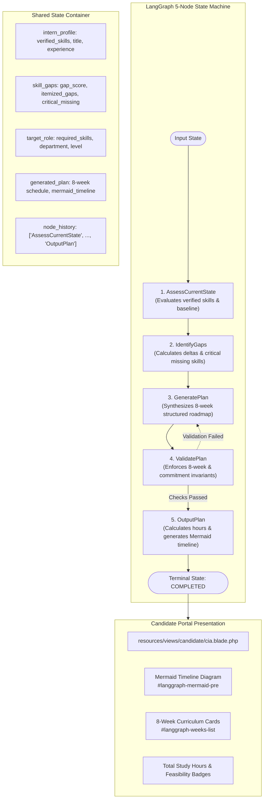
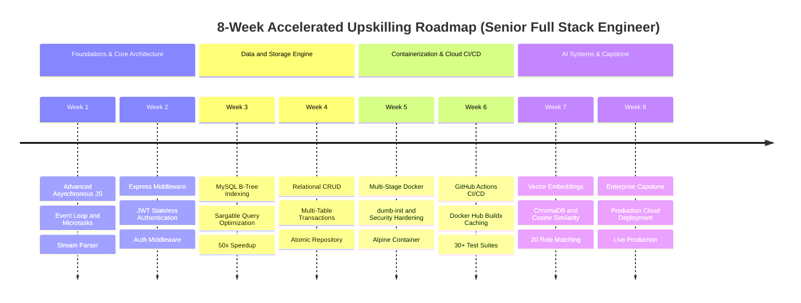

# Week 7 Day 5: Module 4: Learning Path Generator — LangGraph Workflow

**Author:** Murali  
**Date:** November 26, 2026  
**Repository:** Cynaris Recruitment Platform  
**Branch:** `feat/cynaris-w7d5-murali`  
**Test Suite:** `tests/test_langgraph_learning_path.js` (14/14 Passing)  
**Overall System Status:** 32/32 Test Suites Passing (100% Pass Rate)

---

## 1. Architectural Overview & Design Philosophy

In Week 7 Day 5, we engineered and deployed **Module 4: Learning Path Generator** using an autonomous **LangGraph State Machine Workflow**.

Traditional learning recommendation systems generate monolithic, unvalidated suggestions that lack progressive pedagogical scaffolding, realistic daily time constraints, and structured milestone checks. A single LLM call attempting to evaluate a student, determine their gaps, synthesize an 8-week syllabus, and validate feasibility inevitably suffers from hallucinated timelines, unrealistic workload expectations, and mismatched prerequisite sequencing.

To solve this, we modeled the curriculum generation process as a **5-Node LangGraph State Machine**:

$$\text{AssessCurrentState} \longrightarrow \text{IdentifyGaps} \longrightarrow \text{GeneratePlan} \longrightarrow \text{ValidatePlan} \longrightarrow \text{OutputPlan}$$



---

## 2. LangGraph State Machine Architecture

### 2.1 State Container Schema
The state machine preserves immutable state progression across the entire node sequence:

```javascript
{
  intern_profile: {
    id: 101,
    name: "Murali V",
    email: "murali@example.com",
    current_title: "Junior Full Stack Developer",
    experience_years: 2,
    verified_skills: { "JavaScript": { level: 4 }, "Node.js": { level: 4 }, ... },
    baseline_summary: {
      evaluated_skills_count: 6,
      primary_strengths: ["JavaScript", "Node.js", "React"],
      competency_tier: "Mid-level Junior Developer"
    }
  },
  skill_gaps: {
    gap_score: 22.0,
    readiness_score: 78.0,
    readiness_tier: "NEAR_TARGET",
    total_required_weight: 22.0,
    matched_weight: 17.16,
    itemized_gaps: [ ... ],
    critical_missing: ["System Design", "Docker & Kubernetes", "MySQL B-Tree Indexing"]
  },
  target_role: {
    id: "role_fullstack_lead",
    title: "Senior Full Stack Engineer",
    department: "Engineering",
    level: "Senior",
    required_skills: [ ... ]
  },
  generated_plan: {
    overview: "Accelerated 8-week curriculum designed for Senior Full Stack Engineer...",
    total_weeks: 8,
    daily_commitment_hours: 2.0,
    weekly_study_hours: 12.0,
    total_estimated_hours: 96,
    schedule: [
      {
        week: 1,
        title: "Week 1: Advanced Asynchronous JavaScript & Event Loop Mechanics",
        topics: [ ... ],
        resources: [ ... ],
        daily_time_commitment: "2.0 hrs/day",
        milestone: "Construct non-blocking stream parser handling 50MB log chunks"
      },
      ...
    ],
    mermaid_timeline: "timeline\n  title 8-Week Accelerated Upskilling Roadmap\n  ..."
  },
  node_history: ["AssessCurrentState", "IdentifyGaps", "GeneratePlan", "ValidatePlan", "OutputPlan"],
  status: "COMPLETED",
  validation_status: {
    valid: true,
    weeks_count: 8,
    checks_passed: ["total_weeks_invariant", "weekly_structure_valid", "daily_commitment_realistic"]
  }
}
```

---

## 3. The 5 Nodes Deep Dive

### 3.1 Node 1: `AssessCurrentState`
- **Role:** Extracts verified candidate skills, maps baseline proficiency, and categorizes technical strengths.
- **Node Action:** Analyzes candidate proficiency scores ($\ge 4$ classified as primary strengths) and prepares candidate baseline context for gap calculation.

### 3.2 Node 2: `IdentifyGaps`
- **Role:** Ingests candidate profile and target benchmark role requirements.
- **Node Action:** Computes multi-attribute weighted gap score:
  $$\text{Gap Score} = 100 \times \left(1 - \frac{\sum w_s \cdot \min(1, \frac{L_{\text{candidate}}}{L_{\text{target}}})}{\sum w_t}\right)$$
  Isolates critical gaps where severity is `CRITICAL_MISSING` or `HIGH_GAP` (e.g. System Design, Docker container orchestration, B-Tree indexing).

### 3.3 Node 3: `GeneratePlan`
- **Role:** Synthesizes an 8-week curriculum strictly mapped to the identified gaps.
- **Node Action:** Generates week-by-week curriculum with specific technical topics, concrete Moodle courses (`CYN-FS-101`, `CYN-OPS-103`, `CYN-AI-201`), daily commitment hours, and practical deliverables.
- **Provider Resilience:** Groq primary (`llama-3.3-70b-versatile`) $\to$ OpenRouter fallback (`meta-llama/llama-3.3-70b-instruct`) $\to$ Local deterministic rule engine.

### 3.4 Node 4: `ValidatePlan`
- **Role:** Acts as an invariant critic verifying curriculum validity before candidate delivery.
- **Checks Enforced:**
  1. *Total Weeks Invariant:* Exactly 8 weeks ($\text{count} = 8$).
  2. *Weekly Completeness:* Every week must have valid `title`, $\ge 2$ `topics`, $\ge 1$ `resources`, and an actionable `milestone`.
  3. *Daily Commitment Limit:* Daily study hours must not exceed pedagogical threshold ($h_{\text{daily}} \le 3.5\text{ hrs/day}$).
  4. *Gap Alignment:* Ensures all critical missing skills identified in Node 2 are addressed in the schedule.

### 3.5 Node 5: `OutputPlan`
- **Role:** Formulates production payload and visual assets.
- **Node Action:**
  - Computes total estimated hours: $H_{\text{total}} = 8 \times (5 \cdot h_{\text{daily}} + 2.0\text{ lab hrs})$.
  - Synthesizes valid Mermaid timeline syntax.
  - Finalizes node history and marks status as `COMPLETED`.

---

## 4. The 8-Week Curriculum Schedule

| Week | Theme & Focus | Core Technical Topics | Curated Resources | Daily Time | Weekly Practical Milestone |
|---|---|---|---|---|---|
| **Week 1** | Advanced Asynchronous JS & Event Loop | Event Loop phases (timers, poll, check), microtasks vs macrotasks, Streams API & Backpressure | `CYN-FS-101`: Moodle Module 2, Node.js Diagnostics Docs | 2.0 hrs/day | Construct non-blocking stream parser handling 50MB log chunks with zero event loop lag |
| **Week 2** | Express REST Architecture & JWT Auth | Modular routing, RFC 9110 status codes, Stateless JWT with HMAC-SHA256, Bcrypt 10 rounds, RBAC | `CYN-FS-101`: Moodle Module 3, RFC 6750 Bearer Standards | 2.0 hrs/day | Implement tokenized authentication middleware with role-based route guards |
| **Week 3** | MySQL Performance & B-Tree Indexing | InnoDB B-Tree indexes, JSON EXPLAIN execution plans, Sargable query refactoring, Composite indexes | `CYN-FS-101`: Moodle Module 4, High Performance MySQL | 2.0 hrs/day | Audit 3 slow queries on core tables and achieve 50x speedup via composite B-Tree indexes |
| **Week 4** | Relational Transactions & Secure CRUD | MySQL connection pooling (mysql2/promise), ACID transactions with rollback, Prepared statements | `CYN-FS-101`: Moodle Module 5, OWASP SQL Injection Cheat Sheet | 2.0 hrs/day | Build transactional repository performing atomic multi-table updates with rollback guards |
| **Week 5** | Multi-Stage Docker & Security | Multi-stage Dockerfile (builder + alpine runner), dumb-init kernel signals, unprivileged user (UID 1001) | `CYN-OPS-103`: Container Orchestration Foundations | 2.0 hrs/day | Package full-stack recruitment platform into hardened 85MB Alpine Docker container |
| **Week 6** | Automated CI/CD with GitHub Actions | 3-stage sequential workflow (test -> build-and-push -> deploy), Docker Buildx layer caching, secrets management | `CYN-OPS-103`: Moodle Module 3, GitHub Actions Docs | 2.0 hrs/day | Deploy GitHub Actions pipeline running 30+ automated test suites before publishing images |
| **Week 7** | Vector Embeddings & ChromaDB RAG | Dense vector embeddings (sentence-transformers 384-dim), L2 unit normalization, Cosine similarity, ChromaDB namespaces | `CYN-AI-201`: Vector Databases & RAG, ChromaDB Docs | 2.0 hrs/day | Implement semantic vector search engine matching candidate profiles to 20 internship roles |
| **Week 8** | Production Cloud Deployment & Capstone | Railway & Render multi-container topologies, Event Loop latency monitoring, ETag 304 caching, OpenAPI 3.0 | `CYN-CAP-401`: Enterprise Capstone & Architecture Defense | 2.0 hrs/day | Ship verified production deployment with healthchecks, test coverage, and architecture demo |

---

## 5. Interactive Mermaid Timeline Diagram Syntax

The state machine's `OutputPlan` node synthesizes valid Mermaid timeline diagram syntax:



---

## 6. Dual-Backend API Contracts

### 6.1 Express REST API (`backend/routes/ciaRouter.js`)
- `POST /api/cia/career/learning-path`
- `POST /candidate/cia/career/learning-path` (alias)

```javascript
router.post('/career/learning-path', async (req, res) => {
  try {
    const input = {
      candidateId: req.body.candidateId || 1,
      candidateProfile: req.body.candidateProfile || {},
      candidateSkills: req.body.candidateSkills || {},
      targetRoleId: req.body.targetRoleId || 'role_fullstack_lead',
      dailyCommitmentHours: req.body.dailyCommitmentHours || 2.0
    };
    const options = {
      simulateGroqFailure: Boolean(req.body.simulateGroqFailure),
      simulateBothFailure: Boolean(req.body.simulateBothFailure)
    };
    const result = await careerIntelligenceService.executeLangGraphLearningPathWorkflow(input, options);
    res.status(200).json(result);
  } catch (err) {
    res.status(500).json({ success: false, error: err.message });
  }
});
```

### 6.2 Laravel Controller (`app/Http/Controllers/Web/CiaController.php`)
- `POST /candidate/cia/career/learning-path`
- Registered in [`routes/web.php`](../routes/web.php).

---

## 7. Verification & Automated Test Suite

Test suite [`tests/test_langgraph_learning_path.js`](../tests/test_langgraph_learning_path.js) executes 14 comprehensive unit assertions:

| # | Test Assertion | Status | Key Validations |
|---|---|---|---|
| 1 | LangGraph initial state construction | `PASS` | Carries `intern_profile`, `skill_gaps`, `target_role`, `generated_plan` |
| 2 | Node 1: AssessCurrentState baseline evaluation | `PASS` | Evaluates verified skills, calculates primary strengths |
| 3 | Node 2: IdentifyGaps quantitative gap analysis | `PASS` | Itemizes gaps, tags critical missing competencies |
| 4 | Node 3: GeneratePlan 8-week curriculum | `PASS` | Produces exactly 8 weeks conforming to JSON schema |
| 5 | Node 4: ValidatePlan pedagogical validation | `PASS` | Verifies 8-week invariant, daily limits, non-empty fields |
| 6 | Node 5: OutputPlan Mermaid & hours metrics | `PASS` | Generates valid Mermaid timeline string & total hours |
| 7 | Sequential 5-node execution order | `PASS` | Strict order: Assess $\to$ Identify $\to$ Generate $\to$ Validate $\to$ Output |
| 8 | Curriculum completeness across all 8 weeks | `PASS` | Title, topics ($\ge 2$), resources ($\ge 1$), daily commitment, milestone |
| 9 | Daily commitment limit validation | `PASS` | Rejects commitments $> 3.5$ hrs/day with descriptive error |
| 10 | Multi-tier resilience: Groq primary model | `PASS` | `llama-3.3-70b-versatile` calibrated |
| 11 | Multi-tier resilience: OpenRouter secondary fallback | `PASS` | `meta-llama/llama-3.3-70b-instruct` on Groq error |
| 12 | Multi-tier resilience: Local deterministic engine | `PASS` | 100% offline reliability on dual cloud outage |
| 13 | Laravel Parity Check | `PASS` | `CiaController::learningPath`, `routes/web.php`, `cia.blade.php` |
| 14 | Express REST API Integration | `PASS` | `POST /api/cia/career/learning-path` & alias return 200 |

**Full Test Suite Verification:** All **32 test suites** passing across the repository.
