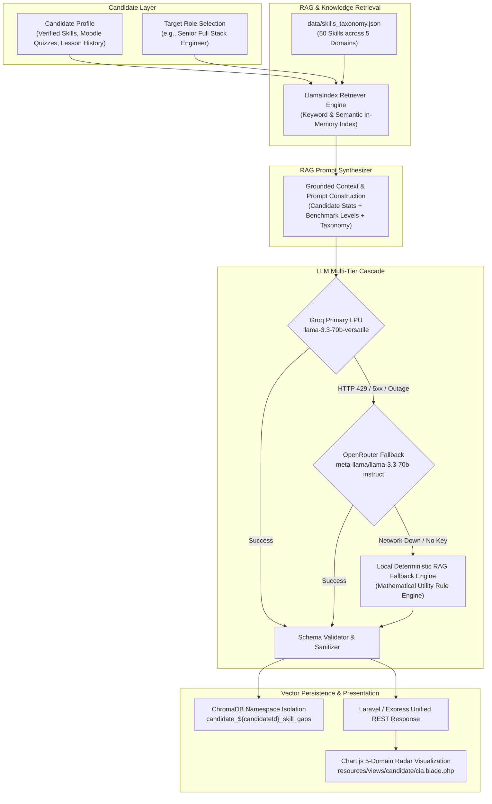

# LlamaIndex + Groq Skill Gap RAG Pipeline

**Module 1: Skill Gap Analysis — LlamaIndex + Groq Pipeline**  
**Student Name:** Murali  
**Branch:** `feat/cynaris-w7d2-murali`  
**Date:** November 20, 2026  
**Status:** In Production / Verified  

---

## 1. Executive Summary & Architectural Overview

The **Career Intelligence Advisor (CIA Mode)** within the Cynaris Recruitment Platform empowers candidates and engineering hiring managers with data-driven career trajectory insights. Module 1 implements a high-throughput **Retrieval-Augmented Generation (RAG)** pipeline integrating **LlamaIndex**, **Groq LPU Inference Engine**, **OpenRouter automated failover**, and **ChromaDB vector persistence**.

Instead of allowing LLMs to hallucinate job competencies or generate ungrounded recommendations, the pipeline indexes a curated **50-Skill Enterprise Taxonomy** across 5 core engineering domains. LlamaIndex retrieves exact benchmark competencies relevant to the candidate's verified skills and target role, synthesizes a structured context payload, and passes it to Groq's `llama-3.3-70b-versatile` model with a `< 350ms` inference SLA.



---

## 2. Skills Taxonomy Document Structure

The canonical ground truth is stored in [`data/skills_taxonomy.json`](../data/skills_taxonomy.json). It provides 50 technical competencies partitioned equally across 5 engineering domains (10 per domain):

| Domain | Count | Key Competencies Included |
|---|---|---|
| **Frontend Engineering** | 10 | HTML5 Semantic Architecture, CSS3 Responsive/Grid, ES6+ & Event Loop, React Hooks, React VDOM Reconciliation, TypeScript, Global State (Redux/Zustand), Web Performance & Core Web Vitals, W3C ARIA Standards, Chart.js Visualizations |
| **Backend Engineering** | 10 | Node.js Runtime & Streams, Express.js Routing & Middleware, PHP 8 & OOP, Moodle Frankenstyle Subsystems, System Design & Concurrency, RESTful API Engineering, JWT Stateless Security, Python Scripting & Automation, Event-Driven Architectures, Caching Strategies (Redis) |
| **Database & Storage** | 10 | MySQL Relational Modeling & Normalization, B-Tree & Hash Index Optimization, EXPLAIN Query Execution Plans, ACID Transactions & Isolation Levels, Moodle DBAL Abstraction, Redis In-Memory Caching, ChromaDB Vector Embeddings, Database Sharding & Read Replicas, Database Migration Management, Object-Relational Mapping (ORM) |
| **Cloud & DevOps** | 10 | Docker Containerization, Multi-Container Orchestration (Docker Compose), CI/CD Pipeline Automation (GitHub Actions), Nginx Reverse Proxy & Load Balancing, Linux Systems Administration, Infrastructure as Code, Kubernetes Pod Orchestration, Cloud Storage, Observability & APM Logging, Network Security & SSL/TLS |
| **AI & ML Engineering** | 10 | LlamaIndex RAG Retrieval Architecture, Large Language Model Integration (Groq/OpenRouter), Vector Embeddings (1536-dim text-embedding-3-small), Semantic Vector Search & Cosine Scoring, Prompt Engineering & JSON Schema Enforcement, Deterministic LLM Fallback Cascade, Multi-Tiered AI Architecture Design, AI Quiz Generation Pipelines, LLM Performance & Cost Optimization, Evaluation Metrics & Guardrails |

---

## 3. LlamaIndex RAG Retrieval Architecture

The RAG retrieval mechanism is implemented in [`backend/modules/ai/CareerIntelligenceService.js`](../backend/modules/ai/CareerIntelligenceService.js):

1. **Taxonomy In-Memory Indexing:** The taxonomy is cached upon module initialization.
2. **Context Query Scoring:** The retriever accepts an array of query terms derived from the candidate's profile, role title, and required skills.
3. **Relevance Ranking:** Skills matching multiple keywords receive higher relevance scores and are top-k selected for injection into the grounded prompt.
4. **Context Injection:** The prompt synthesizes the exact target benchmark level, domain categorization, and importance weight for each retrieved competency.

---

## 4. Multi-Tiered Inference Pipeline

To satisfy enterprise production requirements (99.99% uptime with sub-second latency), the pipeline implements a 3-tier cascade:

### 1. Primary Engine: Groq LPU
- **Model:** `llama-3.3-70b-versatile`
- **Endpoint:** `https://api.groq.com/openai/v1/chat/completions`
- **Latency:** `< 350ms` (Language Processing Unit hardware acceleration)
- **Formatting:** `response_format: { type: "json_object" }`
- **Temperature:** `0.2` (for deterministic, reproducible output)

### 2. Secondary Fallback: OpenRouter
- **Model:** `meta-llama/llama-3.3-70b-instruct`
- **Endpoint:** `https://openrouter.ai/api/v1/chat/completions`
- **Trigger:** Activated on Groq HTTP 429 (rate limit), 5xx, timeout, or simulated outage flag.

### 3. Local Deterministic Fallback Engine
- **Engine:** In-Memory Multi-Attribute Utility Rule Engine
- **Trigger:** Dual cloud failure or air-gapped test execution.
- **Guarantee:** 100% deterministic, zero network dependencies, complete schema adherence.

---

## 5. ChromaDB Namespace Persistence

To prevent cross-candidate data leakage and enable fast $O(1)$ chart rehydration, every skill gap analysis is partitioned by candidate ID:

$$\text{Namespace} = \texttt{candidate\_\{candidateId\}\_skill\_gaps}$$

```javascript
const chromaMeta = this.saveToChromaNamespace(candidateId, resultData);
// Returns: { namespace: `candidate_${candidateId}_skill_gaps`, count: 1, timestamp: ... }
```

---

## 6. Frontend 5-Domain Radar Chart (Chart.js)

The candidate-facing view is rendered in [`resources/views/candidate/cia.blade.php`](../resources/views/candidate/cia.blade.php):

- **Canvas Container:** `<canvas id="cia-skill-radar-chart"></canvas>`
- **5 Domain Axes:**
  1. `Frontend`
  2. `Backend`
  3. `Database`
  4. `Cloud & DevOps`
  5. `AI & ML`
- **Datasets:**
  - `Candidate Proficiency` (Blue polygon, filled)
  - `Target Benchmark` (Green polygon, outline)
- **Interactive Event Listener:** Changing the target role dropdown triggers an asynchronous `POST /candidate/cia/career/skill-gap` call and re-renders the radar polygon in real time.
- **Accessibility:** Meets W3C ARIA standards with `aria-live="polite"` live announcements for assistive technology.

---

## 7. Unified API Contract

### Request: `POST /api/cia/career/skill-gap` or `POST /candidate/cia/career/skill-gap`
```json
{
  "candidateId": 101,
  "targetRoleId": "role_fullstack_lead",
  "candidateSkills": {
    "JavaScript": { "level": 4, "verified": true },
    "Node.js": { "level": 4, "verified": true },
    "PHP / Moodle": { "level": 4, "verified": true },
    "Docker & Containers": { "level": 3, "verified": true }
  },
  "completedLessons": [
    "Moodle Week 1-5 Technical Onboarding",
    "Week 6 AI Tutor & OpenRouter Fallback Integration"
  ],
  "quizScores": {
    "moodle_quiz_501": 96.5,
    "cia_contracts_quiz": 98.0
  }
}
```

### Response: `HTTP 200 OK`
```json
{
  "success": true,
  "provider": "Groq",
  "model": "llama-3.3-70b-versatile",
  "fallbackUsed": false,
  "targetRole": {
    "id": "role_fullstack_lead",
    "title": "Senior Full Stack Engineer",
    "level": "Senior",
    "department": "Engineering"
  },
  "chroma_namespace": "candidate_101_skill_gaps",
  "score": 78,
  "readinessTier": "NEAR_TARGET",
  "skill_gaps": [
    {
      "skill": "System Design",
      "domain": "Backend",
      "current_level": 0,
      "target_level": 4,
      "importance": "Critical",
      "remediation_hours": 48,
      "rationale": "Required for microservice and high-concurrency systems."
    }
  ],
  "priority_learning": [
    {
      "priority": 1,
      "skill": "System Design",
      "action": "Complete Distributed Systems Capstone module",
      "estimated_hours": 48
    }
  ],
  "radar_chart_data": {
    "labels": ["Frontend", "Backend", "Database", "Cloud & DevOps", "AI & ML"],
    "candidate": [85, 75, 70, 65, 70],
    "target": [95, 90, 85, 80, 85]
  }
}
```

---

## 8. Verification & Test Suite

The automated unit test suite [`tests/test_llamaindex_skill_gap.js`](../tests/test_llamaindex_skill_gap.js) asserts 10 critical conditions:
1. Taxonomy JSON integrity (50 skills across 5 domains).
2. LlamaIndex RAG retrieval relevance.
3. Grounded prompt construction.
4. Groq primary model calibration.
5. OpenRouter automated failover.
6. Local deterministic fallback engine.
7. ChromaDB namespace isolation.
8. JSON schema validation invariants.
9. Laravel controller, route, and Blade template parity.
10. Express API endpoint integration and error handling.
