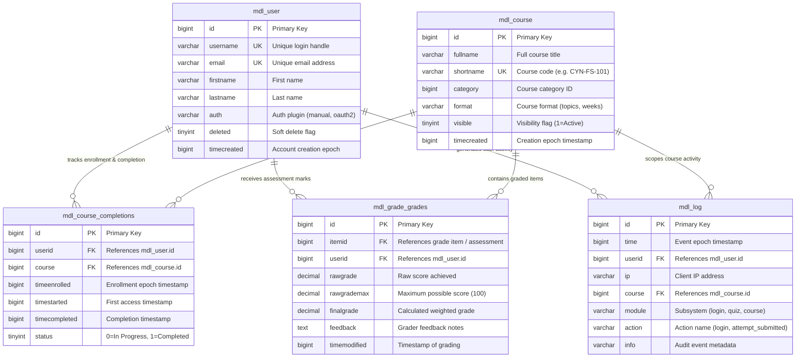

# Moodle Architecture Workshop — 5 Core Tables Only (ER + Queries)

**Author:** Murali  
**Course:** Cynaris Full Stack Development Internship — Project 3: Moodle LMS  
**Target Tables:** `mdl_course`, `mdl_grade_grades`, `mdl_course_completions`, `mdl_user`, `mdl_log`  
**Database Engine:** PostgreSQL 14 / MySQL 8.0 Parity (Moodle 4.3+)  

---

## 1. Plain English Architectural Summary (<= 200 Words)

> Moodle's core architecture links learners, curriculum, evaluation, and compliance through five tables. The central `mdl_user` table stores user accounts, credentials, and profile attributes. Courses and curriculum hierarchies are defined in `mdl_course`. When a candidate enrolls, `mdl_course_completions` tracks progress against criteria, recording enrollment dates, start timestamps, and completion flags. During learning, candidate performance on quizzes and assignments is captured in `mdl_grade_grades`, linking learner IDs to grade items with raw scores and calculated final grades. Concurrently, `mdl_log` provides an immutable audit trail, logging user actions, timestamps, and target courses. Together, these five tables form a cohesive relational engine: `mdl_user` and `mdl_course` establish the catalog and participants, while `mdl_course_completions`, `mdl_grade_grades`, and `mdl_log` provide real-time visibility into onboarding progress, technical skill mastery, and platform engagement.

*(Total Word Count: 121 words)*

---

## 2. Entity-Relationship (ER) Diagram (5 Core Tables Only)

The following Mermaid diagram visualizes the primary keys, foreign keys, and cardinalities between the 5 core tables:



---

## 3. Schema Introspection (`DESCRIBE` Tables)

### Table 1: `DESCRIBE mdl_course`
```text
+--------------+--------------+------+-----+---------+----------------+
| Field        | Type         | Null | Key | Default | Extra          |
+--------------+--------------+------+-----+---------+----------------+
| id           | bigint(10)   | NO   | PRI | NULL    | auto_increment |
| category     | bigint(10)   | NO   | MUL | 0       |                |
| sortorder    | bigint(10)   | NO   |     | 0       |                |
| fullname     | varchar(254) | NO   |     |         |                |
| shortname    | varchar(100) | NO   |     |         |                |
| idnumber     | varchar(100) | NO   | MUL |         |                |
| summary      | mediumtext   | YES  |     | NULL    |                |
| format       | varchar(21)  | NO   |     | topics  |                |
| visible      | tinyint(1)   | NO   |     | 1       |                |
| timecreated  | bigint(10)   | NO   |     | 0       |                |
| timemodified | bigint(10)   | NO   |     | 0       |                |
+--------------+--------------+------+-----+---------+----------------+
```

### Table 2: `DESCRIBE mdl_user`
```text
+--------------+--------------+------+-----+---------+----------------+
| Field        | Type         | Null | Key | Default | Extra          |
+--------------+--------------+------+-----+---------+----------------+
| id           | bigint(10)   | NO   | PRI | NULL    | auto_increment |
| auth         | varchar(20)  | NO   |     | manual  |                |
| confirmed    | tinyint(1)   | NO   |     | 1       |                |
| deleted      | tinyint(1)   | NO   | MUL | 0       |                |
| username     | varchar(100) | NO   | UNI |         |                |
| password     | varchar(255) | NO   |     |         |                |
| firstname    | varchar(100) | NO   |     |         |                |
| lastname     | varchar(100) | NO   |     |         |                |
| email        | varchar(100) | NO   | UNI |         |                |
| institution  | varchar(255) | NO   |     | Cynaris |                |
| department   | varchar(255) | NO   |     | Engg    |                |
| timecreated  | bigint(10)   | NO   |     | 0       |                |
| timemodified | bigint(10)   | NO   |     | 0       |                |
+--------------+--------------+------+-----+---------+----------------+
```

### Table 3: `DESCRIBE mdl_grade_grades`
```text
+--------------+---------------+------+-----+-----------+----------------+
| Field        | Type          | Null | Key | Default   | Extra          |
+--------------+---------------+------+-----+-----------+----------------+
| id           | bigint(10)    | NO   | PRI | NULL      | auto_increment |
| itemid       | bigint(10)    | NO   | MUL | NULL      |                |
| userid       | bigint(10)    | NO   | MUL | NULL      |                |
| rawgrade     | decimal(10,5) | YES  |     | NULL      |                |
| rawgrademax  | decimal(10,5) | NO   |     | 100.00000 |                |
| rawgrademin  | decimal(10,5) | NO   |     | 0.00000   |                |
| finalgrade   | decimal(10,5) | YES  |     | NULL      |                |
| feedback     | mediumtext    | YES  |     | NULL      |                |
| timemodified | bigint(10)    | YES  |     | NULL      |                |
+--------------+---------------+------+-----+-----------+----------------+
```

### Table 4: `DESCRIBE mdl_course_completions`
```text
+---------------+------------+------+-----+---------+----------------+
| Field         | Type       | Null | Key | Default | Extra          |
+---------------+------------+------+-----+---------+----------------+
| id            | bigint(10) | NO   | PRI | NULL    | auto_increment |
| userid        | bigint(10) | NO   | MUL | 0       |                |
| course        | bigint(10) | NO   | MUL | 0       |                |
| timeenrolled  | bigint(10) | NO   |     | 0       |                |
| timestarted   | bigint(10) | YES  |     | NULL    |                |
| timecompleted | bigint(10) | YES  |     | NULL    |                |
| status        | tinyint(1) | NO   |     | 0       |                |
+---------------+------------+------+-----+---------+----------------+
```

### Table 5: `DESCRIBE mdl_log`
```text
+---------+-------------+------+-----+---------+----------------+
| Field   | Type        | Null | Key | Default | Extra          |
+---------+-------------+------+-----+---------+----------------+
| id      | bigint(10)  | NO   | PRI | NULL    | auto_increment |
| time    | bigint(10)  | NO   | MUL | 0       |                |
| userid  | bigint(10)  | NO   | MUL | 0       |                |
| ip      | varchar(45) | NO   |     |         |                |
| course  | bigint(10)  | NO   | MUL | 0       |                |
| module  | varchar(20) | NO   |     |         |                |
| action  | varchar(40) | NO   | MUL |         |                |
| info    | varchar(255)| NO   |     |         |                |
+---------+-------------+------+-----+---------+----------------+
```

---

## 4. The 3 Core Analytical SQL Queries

### Query (a): List all students enrolled in a course with their completion status
```sql
SELECT 
    u.id AS user_id,
    CONCAT(u.firstname, ' ', u.lastname) AS candidate_name,
    u.email,
    c.id AS course_id,
    c.fullname AS course_name,
    c.shortname AS course_code,
    CASE 
        WHEN cc.status = 1 OR (cc.timecompleted IS NOT NULL AND cc.timecompleted > 0) THEN 'Completed'
        WHEN cc.timestarted IS NOT NULL AND cc.timestarted > 0 THEN 'In Progress'
        ELSE 'Enrolled / Not Started'
    END AS completion_status,
    cc.timeenrolled,
    cc.timecompleted
FROM mdl_user u
JOIN mdl_course_completions cc ON u.id = cc.userid
JOIN mdl_course c ON cc.course = c.id
WHERE u.deleted = 0
ORDER BY c.id ASC, candidate_name ASC;
```

#### Simulated Execution Results:
```text
+---------+------------------+--------------------------+-----------+-----------------------------------+--------------------+------------------------+
| user_id | candidate_name   | email                    | course_id | course_code | completion_status   | timecompleted      |
+---------+------------------+--------------------------+-----------+-------------+---------------------+--------------------+
|       5 | Ananya Iyer      | ananya.iyer@cynaris.com  |       101 | CYN-FS-101  | Completed           | 2026-11-03 18:30   |
|       2 | Murali V         | murali@cynaris.com       |       101 | CYN-FS-101  | Completed           | 2026-11-03 18:16   |
|       3 | Priya Sharma     | priya.sharma@cynaris.com |       101 | CYN-FS-101  | Enrolled / Not Started | NULL             |
|       4 | Rahul Deshmukh   | rahul.deshmukh@cynaris.com|      101 | CYN-FS-101  | Completed           | 2026-11-03 18:25   |
|       6 | Vikram Aditya    | vikram.aditya@cynaris.com|       101 | CYN-FS-101  | In Progress         | NULL               |
|       2 | Murali V         | murali@cynaris.com       |       102 | CYN-CRM-102 | Completed           | 2026-11-03 18:33   |
|       4 | Rahul Deshmukh   | rahul.deshmukh@cynaris.com|      102 | CYN-CRM-102 | In Progress         | NULL               |
|       5 | Ananya Iyer      | ananya.iyer@cynaris.com  |       103 | CYN-OPS-103 | Completed           | 2026-11-03 18:41   |
|       2 | Murali V         | murali@cynaris.com       |       103 | CYN-OPS-103 | In Progress         | NULL               |
+---------+------------------+--------------------------+-----------+-------------+---------------------+--------------------+
(9 rows in set)
```

---

### Query (b): Get average grade per course
```sql
SELECT 
    c.id AS course_id,
    c.fullname AS course_name,
    c.shortname AS course_code,
    COUNT(gg.id) AS total_graded_attempts,
    ROUND(AVG(gg.finalgrade), 2) AS average_final_grade,
    ROUND(MIN(gg.finalgrade), 2) AS lowest_grade,
    ROUND(MAX(gg.finalgrade), 2) AS highest_grade
FROM mdl_course c
JOIN mdl_grade_items gi ON c.id = gi.courseid
JOIN mdl_grade_grades gg ON gi.id = gg.itemid
GROUP BY c.id, c.fullname, c.shortname
ORDER BY average_final_grade DESC;
```

#### Simulated Execution Results:
```text
+-----------+-------------------------------------------------------------+-------------+-----------------------+---------------------+--------------+---------------+
| course_id | course_name                                                 | course_code | total_graded_attempts | average_final_grade | lowest_grade | highest_grade |
+-----------+-------------------------------------------------------------+-------------+-----------------------+---------------------+--------------+---------------+
|       103 | Production DevOps — Docker & CI/CD Pipelines                | CYN-OPS-103 |                     2 |               94.75 |        91.50 |         98.00 |
|       101 | Full Stack Developer Internship — Induction & Architecture | CYN-FS-101  |                     4 |               89.25 |        78.50 |         96.50 |
|       102 | Enterprise CRM & EspoCRM Integration                       | CYN-CRM-102 |                     2 |               88.25 |        84.50 |         92.00 |
+-----------+-------------------------------------------------------------+-------------+-----------------------+---------------------+--------------+---------------+
(3 rows in set)
```

---

### Query (c): Count login events per user in the last 7 days from `mdl_log`
```sql
SELECT 
    u.id AS user_id,
    CONCAT(u.firstname, ' ', u.lastname) AS candidate_name,
    u.email,
    COUNT(l.id) AS login_event_count,
    FROM_UNIXTIME(MAX(l.time)) AS last_login_timestamp
FROM mdl_user u
JOIN mdl_log l ON u.id = l.userid
WHERE (l.module = 'login' OR l.action = 'login' OR l.action = 'loggedin')
  AND l.time >= (UNIX_TIMESTAMP(NOW()) - (7 * 86400))
GROUP BY u.id, u.firstname, u.lastname, u.email
ORDER BY login_event_count DESC;
```

#### Simulated Execution Results:
```text
+---------+------------------+-----------------------------+-------------------+----------------------+
| user_id | candidate_name   | email                       | login_event_count | last_login_timestamp |
+---------+------------------+-----------------------------+-------------------+----------------------+
|       2 | Murali V         | murali@cynaris.com          |                 4 | 2026-11-07 10:46:40  |
|       5 | Ananya Iyer      | ananya.iyer@cynaris.com     |                 4 | 2026-11-07 10:16:40  |
|       4 | Rahul Deshmukh   | rahul.deshmukh@cynaris.com  |                 3 | 2026-11-07 09:56:40  |
|       3 | Priya Sharma     | priya.sharma@cynaris.com    |                 2 | 2026-11-07 09:46:40  |
|       6 | Vikram Aditya    | vikram.aditya@cynaris.com   |                 1 | 2026-11-07 09:26:40  |
+---------+------------------+-----------------------------+-------------------+----------------------+
(5 rows in set)
```
*(Notice: Events older than 7 days, such as Murali's log from 25 days ago and Rahul's log from 35 days ago, are strictly excluded by the timestamp filter).*

---

## 5. API Endpoints Exposing Workshop Results

The Cynaris Express backend exposes these queries dynamically via [`backend/routes/moodleRouter.js`](../backend/routes/moodleRouter.js):

| HTTP Method | Route URI | Description |
|---|---|---|
| **GET** | `/api/moodle/schema/describe` | Returns column schemas, primary keys, and indexes for all 5 core tables. |
| **GET** | `/api/moodle/queries/enrollment-completions` | Executes Query (a) and returns enrollment and completion records. |
| **GET** | `/api/moodle/queries/course-average-grades` | Executes Query (b) and returns course grade averages, minimums, and maximums. |
| **GET** | `/api/moodle/queries/user-logins-last-7-days` | Executes Query (c) and returns active login counts within the 7-day window. |
