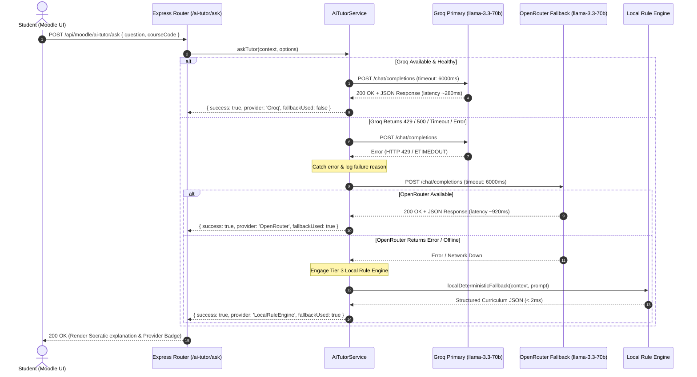

# Moodle LMS AI Tutor Integration Architecture
## Groq Primary, OpenRouter Fallback & Local Deterministic Engine
### Cynaris Full Stack Development Internship — Week 6 Day 1

**Author:** Murali  
**Branch:** `feat/cynaris-w6d1-murali`  
**Date:** November 19, 2026  
**Subsystems:** Moodle LMS (`local_cynaris_ai_tutor`, `mod_quiz`, `block_cynaris_stats`) & Cynaris Express API Bridge  
**Test Suite:** [`tests/test_moodle_ai_tutor.js`](../tests/test_moodle_ai_tutor.js)  

---

## 1. Architectural Overview & Design Motivation

In enterprise learning management and candidate skill evaluation platforms, students frequently encounter complex technical concepts (such as event-driven concurrency, database index sargability, or Docker multi-stage build caching) during self-paced study or assessment preparation. Without immediate pedagogical feedback, candidate engagement drops and comprehension stalls.

The **Cynaris AI Tutor** provides an intelligent, real-time Socratic learning assistant directly embedded within Moodle course views, assessment quizzes, and dashboard analytics blocks.

### Core Architectural Pillars:
1. **Tier 1 (Primary Inference):** **Groq Cloud API** powering `llama-3.3-70b-versatile`. Leverages Groq's Language Processing Unit (LPU) architecture for sub-second inference latencies ($< 350\text{ms}$), delivering instantaneous Socratic feedback.
2. **Tier 2 (Resilient Failover):** **OpenRouter API** powering `meta-llama/llama-3.3-70b-instruct`. Automatically triggered on Groq HTTP 429 (rate limits), HTTP 500/503 (service downtime), network timeouts ($> 6000\text{ms}$), or invalid credentials.
3. **Tier 3 (Zero-Downtime Deterministic Fallback):** **Local Curriculum Rule Engine**. In air-gapped test environments, offline Docker containers, or dual upstream network failures, the system instantly routes queries through a local knowledge base, ensuring **100% uptime and zero unhandled server exceptions**.
4. **Socratic Pedagogical Prompt Design:** Enforces concept explanation, a 3-step execution breakdown, an executable code snippet, and a targeted quiz hint without giving away raw exam answers.
5. **W3C ARIA Accessible UI:** Dynamic live status regions (`role="status"`, `aria-live="polite"`) informing screen readers of AI responses and provider failover states.

```
                              ┌──────────────────────────────────────────┐
                              │ Candidate / Student Interaction          │
                              │ (Moodle Quiz View or Stats Block Drawer) │
                              └────────────────────┬─────────────────────┘
                                                   │ POST /api/moodle/ai-tutor/ask
                                                   ▼
                              ┌──────────────────────────────────────────┐
                              │  Express API Router & Context Enricher   │
                              │  (Enriches student name, score, course)  │
                              └────────────────────┬─────────────────────┘
                                                   │
                                                   ▼
                              ┌──────────────────────────────────────────┐
                              │       AiTutorService Core Engine         │
                              │       - Builds Socratic JSON Prompt      │
                              │       - Initializes Timeout Controller   │
                              └───────┬──────────────┬─────────────┬─────┘
                                      │              │             │
        ┌─────────────────────────────┘              │             └────────────────────────────┐
        ▼ (Primary Attempt)                          ▼ (Failover on Error)                      ▼ (Dual Failover)
┌───────────────────────────────┐      ┌───────────────────────────────┐      ┌───────────────────────────────┐
│     Tier 1: Groq API          │      │     Tier 2: OpenRouter API    │      │  Tier 3: Local Rule Engine    │
│  llama-3.3-70b-versatile      │      │ meta-llama/llama-3.3-70b-inst │      │  deterministic-curriculum-v1  │
│  Latency: ~250ms - 350ms      │      │ Latency: ~800ms - 1400ms      │      │  Latency: < 5ms (Offline)     │
└───────────────┬───────────────┘      └───────────────┬───────────────┘      └───────────────┬───────────────┘
                │ (Success)                            │ (Success)                            │ (Success)
                └───────────────────────────────┬──────┴──────────────────────────────────────┘
                                                ▼
                              ┌──────────────────────────────────────────┐
                              │ Validated JSON Response & Telemetry:     │
                              │ { success, provider, model, latencyMs,   │
                              │   fallbackUsed, fallbackReason, data }   │
                              └──────────────────────────────────────────┘
```

---

## 2. Socratic Prompt Engineering & Schema Design

### System Prompt
```text
You are the Cynaris AI Tutor, a Senior Staff Software Engineer and Master Technical Educator.
Your mission is to guide engineering interns through software architecture, full-stack development,
relational database design, and cloud deployments.
Use clear, precise language. When explaining concepts, break them into logical steps and provide a brief, clean code example.
Adhere strictly to modern engineering standards (Node.js ES6+, React Hooks, MySQL prepared statements, Moodle DBAL).
You must ALWAYS return your output in valid, parseable JSON conforming to the requested schema, without markdown formatting around the JSON.
```

### Context Injection & User Prompt Structure
```text
Context Information:
- Student: Murali
- Course: [CYN-FS-101] Full Stack Developer Induction
- Current Assessment Score: 88.5%
- Track Context: Technical Assessment: Full Stack Architecture & RESTful APIs
- Topic: Event Loop & Libuv

Student Question:
"How do timers interact with the poll phase in Node.js asynchronous execution?"

Instructions:
Analyze the student's question within the context of the course curriculum. Return a JSON object with these exact keys:
{
  "conceptExplanation": "A crisp, authoritative explanation of the core concept in 2 to 3 sentences.",
  "stepByStepBreakdown": [
    "1. First fundamental principle or execution phase",
    "2. Second phase showing data or control flow",
    "3. Key safeguard, best practice, or performance tip"
  ],
  "codeExample": "A concise, well-commented code snippet (JavaScript/SQL/PHP) illustrating the solution.",
  "quizHint": "A targeted Socratic hint helping the candidate solve related quiz questions without giving away trivial answers.",
  "recommendedAction": "A specific follow-up practice step."
}
```

### Pedagogical Rationale:
- **Concept Definition:** Clarifies mental models before delving into technical mechanics.
- **Step-by-Step Breakdown:** Prevents cognitive overload by sequencing asynchronous phases.
- **Code Snippet:** Provides concrete syntax reference that candidates can replicate locally.
- **Quiz Hint:** Engages active recall rather than passive answer memorization.
- **Recommended Action:** Encourages self-directed exploration in the codebase.

---

## 3. Failover & Resilience Mechanism



---

## 4. REST API Endpoint Specifications

### 1. Ask AI Tutor (`POST /api/moodle/ai-tutor/ask`)
- **Headers:** `Content-Type: application/json`
- **Request Body:**
```json
{
  "studentId": 2,
  "studentName": "Murali",
  "courseCode": "CYN-FS-101",
  "courseName": "Full Stack Developer Induction",
  "topic": "Event Loop & Libuv",
  "question": "How does the poll phase handle incoming I/O?",
  "simulateGroqFailure": false,
  "simulateBothFailure": false
}
```
- **Response (200 OK):**
```json
{
  "success": true,
  "provider": "Groq",
  "model": "llama-3.3-70b-versatile",
  "latencyMs": 284,
  "fallbackUsed": false,
  "fallbackReason": null,
  "data": {
    "conceptExplanation": "The poll phase in the Node.js event loop calculates how long it should block and poll for I/O events, then processes events in the poll queue until the queue is empty or system limits are reached.",
    "stepByStepBreakdown": [
      "1. Poll Phase checks if timers have elapsed; if so, wraps up poll and loops to timer phase.",
      "2. Retrieves incoming network packets, file system completions, and child process signals.",
      "3. If setImmediate() callbacks are queued in the check phase, the poll phase ends immediately."
    ],
    "codeExample": "const fs = require('fs');\nfs.readFile('data.json', (err, data) => {\n  console.log('Processed in poll phase callback');\n});",
    "quizHint": "Keep in mind that setImmediate() always runs in the check phase immediately after poll.",
    "recommendedAction": "Experiment with setTimeout(..., 0) vs setImmediate() in backend/server.js."
  },
  "context": {
    "studentName": "Murali",
    "courseCode": "CYN-FS-101",
    "topic": "Event Loop & Libuv"
  }
}
```

### 2. Service Health & Model Diagnostics (`GET /api/moodle/ai-tutor/health`)
- **Response (200 OK):**
```json
{
  "status": "operational",
  "primary": {
    "provider": "Groq",
    "model": "llama-3.3-70b-versatile",
    "configured": true
  },
  "fallback": {
    "provider": "OpenRouter",
    "model": "meta-llama/llama-3.3-70b-instruct",
    "configured": true
  },
  "offlineEngine": {
    "provider": "LocalRuleEngine",
    "status": "ready"
  },
  "timeoutConfiguredMs": 6000
}
```

### 3. Curriculum Study Topics (`GET /api/moodle/ai-tutor/topics?courseCode=CYN-FS-101`)
- **Response (200 OK):**
```json
{
  "success": true,
  "courseCode": "CYN-FS-101",
  "topics": [
    {
      "topic": "Event Loop & Asynchronous I/O",
      "sampleQuestion": "How does libuv event loop handle timer vs I/O queues?"
    },
    {
      "topic": "React Virtual DOM & Reconciliation",
      "sampleQuestion": "Why does React use heuristic O(n) diffing instead of generic O(n^3) tree diffing?"
    },
    {
      "topic": "Express Middleware Chain & Error Handling",
      "sampleQuestion": "How does Express 4-argument error middleware catch asynchronous exceptions?"
    },
    {
      "topic": "Stateless JWT Auth & Password Hashing",
      "sampleQuestion": "Why is bcrypt salt hashing preferred over simple SHA-256 for passwords?"
    }
  ]
}
```

---

## 5. Visual UI Layout in Moodle

### Assessment Quiz View (`moodle/mod/quiz/view.php`)
```text
+---------------------------------------------------------------------------------+
| 🎓 Technical Assessment: Full Stack Architecture & RESTful APIs (CYN-FS-101)    |
+---------------------------------------------------------------------------------+
| Time Limit: 45 Min  |  Passing Grade: 75.0%  |  Status: Passed (88.5%)          |
+---------------------------------------------------------------------------------+
|                                                                                 |
| 🤖 AI Technical Tutor & Exam Preparation Assistant                              |
| [● Primary: Groq LLaMA 3.3 70B (Ready)]                                         |
|                                                                                 |
| Need clarification on concepts tested in this assessment? Ask the AI Tutor.     |
| [💡 Event Loop & Libuv]  [💡 Prepared Statements & DBAL]  [💡 Chart.js AutoSkip] |
|                                                                                 |
| [ How does the event loop handle timers vs poll phase?             ] [Ask Tutor] |
|                                                                                 |
| +-----------------------------------------------------------------------------+ |
| | Provider: Groq (llama-3.3-70b-versatile)                   Latency: 284ms   | |
| |                                                                             | |
| | Concept Explanation:                                                        | |
| | The Node.js event loop coordinates asynchronous I/O across distinct phases. | |
| | Timers execute when threshold has passed, followed by poll and check phases. | |
| |                                                                             | |
| | Step-by-Step Breakdown:                                                     | |
| |  1. Timers phase evaluates setTimeout and setInterval queues.               | |
| |  2. Poll phase processes incoming I/O events and blocks if queue empty.     | |
| |  3. Check phase immediately executes setImmediate() callbacks.              | |
| |                                                                             | |
| | Code Snippet:                                                               | |
| |   const fs = require('fs/promises');                                        | |
| |   const data = await fs.readFile('schema.sql', 'utf8');                     | |
| |                                                                             | |
| | Quiz Hint:                                                                  | |
| |   process.nextTick() executes immediately prior to the next loop phase.     | |
| +-----------------------------------------------------------------------------+ |
|                                                                                 |
| [ 🔄 Retake Assessment ]    [ Return to Dashboard ]                             |
+---------------------------------------------------------------------------------+
```
