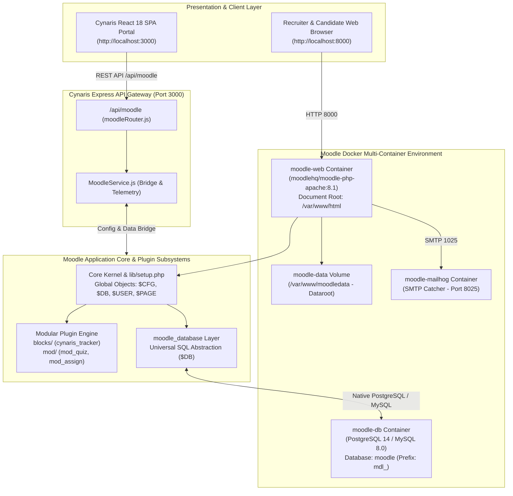

# Moodle LMS Architecture Blueprint — Cynaris Platform Integration

**Project:** Cynaris Recruitment Platform — Project 3: Moodle LMS Integration  
**Version:** Moodle 4.3+ (Build: 20231009)  
**Target Environment:** PHP 8.1 (Apache), PostgreSQL 14 / MySQL 8.0, moodle-docker  
**Local URL:** `http://localhost:8000`  

---

## 1. High-Level Architecture Overview

Moodle (Modular Object-Oriented Dynamic Learning Environment) is the global standard open-source Learning Management System (LMS). In the **Cynaris Recruitment Platform**, Moodle functions as the **Candidate Assessment & Induction LMS Engine**. It coordinates technical screening quizzes (`mod/quiz`), candidate onboarding courses (`mdl_course`), skill evaluations, grade tracking (`mdl_grade_grades`), course completions (`mdl_course_completions`), and audit compliance logs (`mdl_log`).



---

## 2. Three Key Architectural Decisions

### 1. Universal Database Abstraction Layer (`$DB` / `moodle_database`)
- **Architectural Rationale:** Moodle is designed to be completely database-agnostic. Rather than issuing raw SQL queries with vendor-specific syntax, all database operations flow through Moodle's Universal Database Access Layer (`$DB`).
- **Mechanisms:**
  - Implements abstract methods: `$DB->get_record()`, `$DB->get_records()`, `$DB->insert_record()`, `$DB->update_record()`, `$DB->delete_records()`, and `$DB->get_records_sql()`.
  - Enforces named and positional parameter binding (e.g. `WHERE userid = :userid`) to guarantee 100% immunity against SQL injection across all supported relational databases (PostgreSQL, MariaDB, MySQL, MSSQL, Oracle).
  - Uses table prefixing (default `mdl_`), allowing multiple instances to coexist securely within a single enterprise database.

### 2. Modular Pluggable Component Architecture (Frankenstyle Subsystems)
- **Architectural Rationale:** Moodle's core kernel is intentionally minimal. Over 80% of application functionality is delivered through modular plugins distributed across more than 40 discrete plugin types (`mod/`, `blocks/`, `auth/`, `enrol/`, `filter/`, `theme/`, `report/`).
- **Mechanisms:**
  - Employs **Frankenstyle naming conventions** (`mod_quiz`, `block_cynaris_tracker`, `auth_manual`) ensuring deterministic namespaces for class autoloaders, language string packs (`get_string()`), capability definitions (`db/access.php`), and database tables.
  - Custom extensions reside strictly within their plugin directories, ensuring core Moodle files remain completely unmodified, which allows automated upstream security upgrades without regressions.

### 3. Decoupled Security Dataroot Architecture (`$CFG->dataroot` outside webroot)
- **Architectural Rationale:** Web-accessible storage directories represent one of the most critical vulnerabilities in PHP applications (e.g. arbitrary file upload leading to Remote Code Execution).
- **Mechanisms:**
  - Moodle strictly isolates the web-accessible document root (`/var/www/html`) from the persistent data storage directory (`$CFG->dataroot = '/var/www/moodledata'`).
  - All user-submitted files (resumes, quiz submissions, course backups, session caches) are stored in `moodledata` using SHA-1 file content addressing (`filedir`).
  - No client can access uploaded files directly via URL. Every file request is mediated by `pluginfile.php`, which rigorously verifies active user sessions, course enrollments, and granular access capabilities before streaming file bytes.

---

## 3. Directory Structure Breakdown

Moodle organizes its codebase into modular, top-level functional directories:

```text
moodle/
├── admin/               # Site administration, CLI installer, environment checks, and cron
│   ├── cli/             # Command-line tools (install_database.php, upgrade.php, cron.php)
│   └── settings/        # Global administration setting trees
├── auth/                # Authentication subsystem plugins (manual, ldap, oauth2, saml2)
├── blocks/              # Sidebar and dashboard widget block plugins
│   └── cynaris_tracker/ # Custom Candidate Progress Tracker block for Cynaris Platform
│       ├── block_cynaris_tracker.php # Main block class extending block_base
│       ├── version.php  # Component version and maturity metadata
│       ├── db/access.php# Block instance capabilities (myaddinstance, addinstance)
│       └── lang/en/     # English localization string definitions
├── course/              # Course creation, section formats, categories, and enrollment controls
├── enrol/               # Enrollment mechanism plugins (manual, self, cohort, guest, paypal)
├── grade/               # Centralized gradebook engine, aggregation formulas, and grade exports
├── lang/                # Core localization packs (en, es, fr, de, etc.)
├── lib/                 # Core framework libraries, DBAL drivers, setup.php, and output renderers
├── mod/                 # Course activity modules (interactive learning components)
│   └── quiz/            # Core Technical Assessment Quiz subsystem
│       ├── lib.php      # Activity lifecycle functions (quiz_add_instance, quiz_get_user_grades)
│       ├── version.php  # Module component version
│       ├── view.php     # Quiz attempt controller and landing page
│       └── db/          # Activity database tables (quiz, quiz_attempts, quiz_grades)
├── theme/               # User interface themes and responsive layout templates (Boost, Classic)
├── config.docker-template.php # moodlehq/moodle-docker configuration template
├── config.php           # Active runtime configuration generated from template
├── index.php            # Primary frontpage and dashboard router
└── version.php          # Core Moodle release specification and database schema version
```

---

## 4. Database Schema Specifications (Key 5 Tables)

Moodle persists learning and assessment history across structured relational tables prefixed with `mdl_`:

### 1. `mdl_course` (Course Master Catalog)
Stores courses, categories, visibility status, and layout formats:
- `id` (BIGINT, PK): Unique course identifier.
- `fullname` (VARCHAR 254): Full course title (e.g., "Full Stack Developer Induction").
- `shortname` (VARCHAR 100): Unique human-readable code (e.g., "CYN-FS-101").
- `category` (BIGINT): Course category foreign key.
- `summary` (TEXT): Course description and learning objectives.
- `format` (VARCHAR 21): Layout format (e.g., `topics`, `weeks`).
- `visible` (SMALLINT): 1 = Active / Published, 0 = Hidden.

### 2. `mdl_user` (Learner & Recruiter Directory)
Stores user accounts, authentication types, and personal profiles:
- `id` (BIGINT, PK): Unique user identifier.
- `username` (VARCHAR 100, UK): Unique login handle.
- `password` (VARCHAR 255): Bcrypt or Argon2 password hash.
- `firstname`, `lastname` (VARCHAR 100): Candidate full name.
- `email` (VARCHAR 100, UK): Candidate corporate email.
- `institution`, `department` (VARCHAR 255): Organizational assignment.
- `auth` (VARCHAR 20): Authentication plugin (e.g., `manual`, `oauth2`).

### 3. `mdl_grade_grades` (Assessment Outcomes & Scores)
Stores individual learner grades for quizzes, assignments, and course finals:
- `id` (BIGINT, PK): Unique grade outcome identifier.
- `itemid` (BIGINT, FK): References `mdl_grade_items.id` (e.g., Quiz #501).
- `userid` (BIGINT, FK): References `mdl_user.id`.
- `finalgrade` (DECIMAL 10,5): Final calculated grade score (e.g., `96.50000`).
- `rawgrademax` (DECIMAL 10,5): Maximum possible score (e.g., `100.00000`).
- `feedback` (TEXT): Grader or automated AI evaluation notes.
- `timemodified` (BIGINT): Unix epoch timestamp of last grade adjustment.

### 4. `mdl_course_completions` (Course Completion Tracking)
Tracks candidate progress against predefined completion criteria:
- `id` (BIGINT, PK): Completion record identifier.
- `userid` (BIGINT, FK): References `mdl_user.id`.
- `course` (BIGINT, FK): References `mdl_course.id`.
- `timeenrolled` (BIGINT): Unix timestamp when candidate enrolled.
- `timecompleted` (BIGINT): Unix timestamp when completion criteria were met.
- `status` (SMALLINT): 0 = In Progress, 1 = Successfully Completed.

### 5. `mdl_log` / `mdl_logstore_standard_log` (Compliance & Event Audit Trail)
Maintains an immutable audit log of all system interactions:
- `id` (BIGINT, PK): Log event identifier.
- `eventname` (VARCHAR 255): Namespaced event class (e.g., `\mod_quiz\event\attempt_submitted`).
- `component` (VARCHAR 100): Originating subsystem (`mod_quiz`, `core`).
- `action` (VARCHAR 100): CRUD action performed (`created`, `viewed`, `submitted`).
- `userid` (BIGINT): Candidate or recruiter ID.
- `courseid` (BIGINT): Associated course ID.
- `timecreated` (BIGINT): Exact epoch timestamp of event execution.

---

## 5. Local Development Environment (`moodle-docker`)

The local environment runs via `docker-compose.moodle.yml`:
- **Web Port:** `http://localhost:8000`
- **Database Engine:** PostgreSQL 14 (or MySQL 8.0) on port `5432`
- **SMTP Mail Catcher:** MailHog on Web Port `8025`
- **Dataroot Volume:** Persistent named volume `moodle-data` mounted at `/var/www/moodledata`
- **Code Volume:** Local `./moodle` directory mounted to `/var/www/html` for instantaneous hot reloading.
