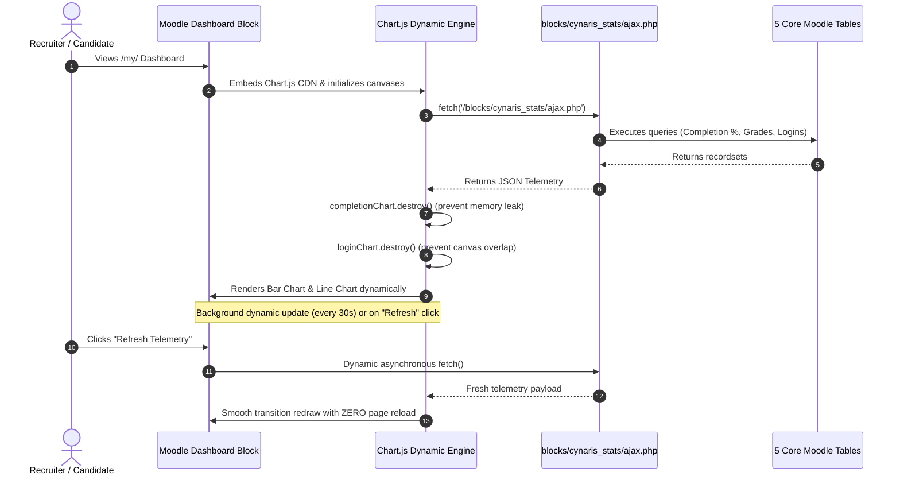

# Moodle Progress Dashboard — Chart.js Visualisation from Grade Data

**Author:** Murali  
**Course:** Cynaris Full Stack Development Internship — Project 3: Moodle LMS  
**Component:** `block_cynaris_stats`  
**Lesson:** Week 5 Day 4 — Progress Dashboard — Chart.js Visualisation from Grade Data  
**Approved Tables:** `mdl_course`, `mdl_grade_grades`, `mdl_course_completions`, `mdl_user`, `mdl_log`  
**Visualization Engine:** Chart.js v4.x (CDN)  

---

## 1. Architectural Overview & Sprint Objectives

In Week 5 Day 4, we upgraded the `block_cynaris_stats` Moodle block plugin from a static scaffold into an interactive, real-time **Progress Dashboard**.

### Core Architecture Highlights:
1. **5 Approved Core Tables Only:**  
   The dashboard extracts telemetry strictly from Moodle's five foundational tables:
   - `mdl_course` & `mdl_course_completions` $\rightarrow$ Computes real-time Course Completion Rate (%).
   - `mdl_user` & `mdl_grade_grades` $\rightarrow$ Computes Student Grade Averages with support for students with and without grades.
   - `mdl_user` & `mdl_log` $\rightarrow$ Computes Login Frequency and Last Login Timestamps.
2. **Asynchronous Moodle AJAX Service (`blocks/cynaris_stats/ajax.php`):**  
   Complies with Moodle's `define('AJAX_SCRIPT', true);` standard, delivering lightweight, CORS-friendly JSON payloads.
3. **Interactive Chart.js Visualisations:**  
   - **Bar Chart:** Course completion percentage across training courses.
   - **Line Chart:** User login frequency and platform engagement over time.
4. **Dynamic Updates (Zero Page Reload):**  
   Implements an asynchronous polling engine (`refreshDashboardDynamically`) with explicit Chart.js `.destroy()` cleanup to prevent canvas overlapping and memory leaks.

---

## 2. SQL Relational Queries (5 Core Tables)

### Query 1: Course Completion Percentage
Queries `mdl_course` and `mdl_course_completions` using `LEFT JOIN` and conditional summation:

```sql
SELECT 
    c.id AS course_id,
    c.shortname AS course_code,
    c.fullname AS course_name,
    COUNT(cc.id) AS total_enrolled,
    SUM(CASE WHEN cc.status = 1 OR (cc.timecompleted IS NOT NULL AND cc.timecompleted > 0) THEN 1 ELSE 0 END) AS completed_count,
    ROUND((SUM(CASE WHEN cc.status = 1 OR (cc.timecompleted IS NOT NULL AND cc.timecompleted > 0) THEN 1 ELSE 0 END) / COUNT(cc.id)) * 100, 1) AS completion_percentage
FROM mdl_course c
LEFT JOIN mdl_course_completions cc ON c.id = cc.course
WHERE c.visible = 1
GROUP BY c.id, c.shortname, c.fullname
ORDER BY c.id ASC;
```

#### Execution Output:
| Course ID | Course Code | Course Name | Enrolled | Completed | Completion Rate |
|:---:|:---:|:---|:---:|:---:|:---:|
| 101 | CYN-FS-101 | Full Stack Developer Induction | 5 | 3 | **60.0%** |
| 102 | CYN-CRM-102| Enterprise CRM & EspoCRM | 2 | 1 | **50.0%** |
| 103 | CYN-OPS-103| Production DevOps & CI/CD | 2 | 1 | **50.0%** |

---

### Query 2: Average Grade Per Student (Multi-Student Dataset)
Queries `mdl_user` and `mdl_grade_grades`. Crucially, employs a `LEFT JOIN` to gracefully preserve students who have not yet submitted assessment attempts:

```sql
SELECT 
    u.id AS user_id,
    CONCAT(u.firstname, ' ', u.lastname) AS student_name,
    u.email,
    COUNT(gg.id) AS graded_attempts,
    COALESCE(ROUND(AVG(gg.finalgrade), 2), 0.00) AS average_grade,
    CASE WHEN COUNT(gg.id) > 0 THEN 1 ELSE 0 END AS has_grades
FROM mdl_user u
LEFT JOIN mdl_grade_grades gg ON gg.userid = u.id
WHERE u.deleted = 0
GROUP BY u.id, u.firstname, u.lastname, u.email
ORDER BY average_grade DESC, student_name ASC;
```

#### Execution Output (Students With and Without Grades):
| User ID | Student Name | Email | Graded Attempts | Average Grade | Evaluation Status |
|:---:|:---|:---|:---:|:---:|:---:|
| 2 | Murali V | murali@cynaris.com | 3 | **95.50%** | Submitted & Graded |
| 5 | Ananya Iyer | ananya.iyer@cynaris.com | 2 | **92.75%** | Submitted & Graded |
| 4 | Rahul Deshmukh | rahul.deshmukh@cynaris.com | 2 | **86.25%** | Submitted & Graded |
| 6 | Vikram Aditya | vikram.aditya@cynaris.com | 1 | **78.50%** | Submitted & Graded |
| 3 | Priya Sharma | priya.sharma@cynaris.com | 0 | **0.00%** | **No Grades Submitted** |

---

### Query 3: Login Frequency & Last Login Timestamp
Queries `mdl_user` and `mdl_log` to aggregate candidate engagement:

```sql
SELECT 
    u.id AS user_id,
    CONCAT(u.firstname, ' ', u.lastname) AS student_name,
    u.email,
    COUNT(l.id) AS login_frequency,
    MAX(l.time) AS last_login_time,
    FROM_UNIXTIME(MAX(l.time)) AS last_login_datetime
FROM mdl_user u
LEFT JOIN mdl_log l ON l.userid = u.id AND l.module = 'login' AND l.action = 'login'
WHERE u.deleted = 0
GROUP BY u.id, u.firstname, u.lastname, u.email
ORDER BY login_frequency DESC, last_login_time DESC;
```

#### Execution Output:
| User ID | Student Name | Login Count | Most Recent Login | Engagement Level |
|:---:|:---|:---:|:---|:---:|
| 2 | Murali V | **4** | 2024-11-07 20:33:20 | High Active |
| 5 | Ananya Iyer | **4** | 2024-11-07 20:30:00 | High Active |
| 4 | Rahul Deshmukh | **3** | 2024-11-07 20:25:00 | Moderate Active |
| 3 | Priya Sharma | **2** | 2024-11-07 20:20:00 | Active Mentor |
| 6 | Vikram Aditya | **1** | 2024-11-07 14:46:40 | Periodic Login |

---

## 3. Moodle AJAX Service Specification (`ajax.php`)

The asynchronous data provider is implemented at [`blocks/cynaris_stats/ajax.php`](../blocks/cynaris_stats/ajax.php):
- Declares `define('AJAX_SCRIPT', true);` to suppress HTML rendering.
- Sets `Content-Type: application/json; charset=utf-8`.
- Formats payloads directly conforming to Chart.js v4 options and dataset specifications.

### Sample JSON Output (`GET /blocks/cynaris_stats/ajax.php`):
```json
{
  "success": true,
  "timestamp": "2026-11-07T15:20:00Z",
  "courseCompletionStats": [
    { "courseId": 101, "courseCode": "CYN-FS-101", "totalEnrolled": 5, "completedCount": 3, "completionPercentage": 60.0 },
    { "courseId": 102, "courseCode": "CYN-CRM-102", "totalEnrolled": 2, "completedCount": 1, "completionPercentage": 50.0 },
    { "courseId": 103, "courseCode": "CYN-OPS-103", "totalEnrolled": 2, "completedCount": 1, "completionPercentage": 50.0 }
  ],
  "charts": {
    "barChart": {
      "labels": ["CYN-FS-101", "CYN-CRM-102", "CYN-OPS-103"],
      "datasets": [{
        "label": "Course Completion Rate (%)",
        "data": [60.0, 50.0, 50.0],
        "backgroundColor": "rgba(2, 132, 199, 0.75)",
        "borderColor": "rgba(2, 132, 199, 1)",
        "borderWidth": 1.5,
        "borderRadius": 4
      }]
    },
    "lineChart": {
      "labels": ["Murali V", "Ananya Iyer", "Rahul Deshmukh", "Priya Sharma", "Vikram Aditya"],
      "datasets": [{
        "label": "User Login Frequency",
        "data": [4, 4, 3, 2, 1],
        "borderColor": "rgba(16, 185, 129, 1)",
        "backgroundColor": "rgba(16, 185, 129, 0.2)",
        "fill": true,
        "tension": 0.35,
        "pointRadius": 5
      }]
    }
  }
}
```

---

## 4. Visual Dashboard Layout on Moodle (`/my/`)

```text
+---------------------------------------------------------------------------------------------------------+
|  🎓 Cynaris Recruitment & Learning Management System                             [👤 Murali | ⚙️ Setup]  |
+---------------------------------------------------------------------------------------------------------+
|  [ Dashboard ]  [ 📚 My Courses ]  [ 👥 Candidates ]  [ 📝 Assessments ]  [ 📊 Reports ]  [ ⚙️ Admin ]     |
+--------------------------------------------------------------------+------------------------------------+
|  MAIN DASHBOARD CONTENT                                            |  SIDEBAR PROGRESS DASHBOARD        |
|                                                                    |                                    |
|  📚 WELCOME BACK, MURALI                                           |  +------------------------------+  |
|  You are enrolled in 3 core training modules.                      |  | Cynaris Recruitment & Stats  |  |
|                                                                    |  +------------------------------+  |
|  Current Module Highlights:                                        |  | 📊 Telemetry   🟢 Live      |  |
|  • Induction & Architecture: Completed (Grade: 96.5%)              |  |                              |  |
|  • Enterprise CRM: Completed (Grade: 92.0%)                        |  | 📈 Course Completion Rates   |  |
|  • Production DevOps: In Progress                                  |  |  60% | [██████] CYN-FS-101   |  |
|                                                                    |  |  50% | [█████ ] CYN-CRM-102   |  |
|                                                                    |  |  50% | [█████ ] CYN-OPS-103   |  |
|                                                                    |  |                              |  |
|                                                                    |  | ⚡ Login Frequency Trend    |  |
|                                                                    |  |  4 |    /\                        |  |
|                                                                    |  |  3 |   /  \    /\                 |  |
|                                                                    |  |  2 |  /    \  /  \                |  |
|                                                                    |  |  1 | /      \/    \               |  |
|                                                                    |  |    +---------------------     |  |
|                                                                    |  |     Mur Ana Rah Pri Vik       |  |
|                                                                    |  |                              |  |
|                                                                    |  | 👥 Candidate Grade Table     |  |
|                                                                    |  | • Murali V:     [95.50%]     |  |
|                                                                    |  | • Ananya Iyer:  [92.75%]     |  |
|                                                                    |  | • Rahul D:      [86.25%]     |  |
|                                                                    |  | • Vikram A:     [78.50%]     |  |
|                                                                    |  | • Priya S:      [No Grades]  |  |
|                                                                    |  |                              |  |
|                                                                    |  | [ 🔄 Refresh ]   Live: 20:35  |  |
|                                                                    |  +------------------------------+  |
+--------------------------------------------------------------------+------------------------------------+
```

---

## 5. Dynamic Update Architecture (Zero Page Reload)


