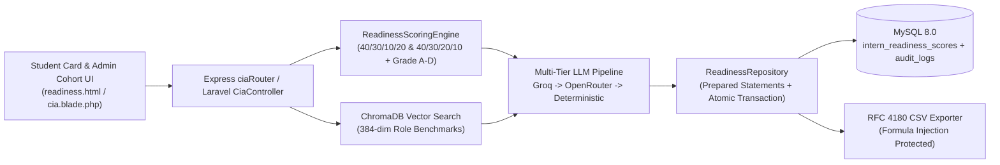

# Module 6 & 7: Placement Readiness Score + Interview Readiness Score Architecture

**Week 8 Day 2 — Cynaris Career Intelligence Platform**  
**Modules:** Module 6 (Placement Readiness Score) & Module 7 (Interview Readiness Score)  
**Database Table:** `intern_readiness_scores` (MySQL 8.0 + In-Memory Fallback)

---

## 1. Architectural Overview

Modules 6 and 7 combine deterministic multi-attribute quantitative scoring, ChromaDB vector role benchmarking, multi-tier LLM reasoning (**Groq** primary $\to$ **OpenRouter** fallback $\to$ **Local Deterministic Engine**), and relational MySQL persistence to give both **Students** and **Admins** an actionable view of placement and interview preparedness.

---

## 2. Quantitative Scoring Formulas

### 2.1 Module 6: Placement Readiness Score (0–100)
$$\text{Placement Score} = (P_{\text{completion}} \times 0.40) + (S_{\text{assessment}} \times 0.30) + (S_{\text{CIA}} \times 0.10) + (Q_{\text{docs}} \times 0.20)$$

Where:
- $P_{\text{completion}} \in [0, 100]$: Project completion percentage (40% weight)
- $S_{\text{assessment}} \in [0, 100]$: Technical assessment & quiz score (30% weight)
- $S_{\text{CIA}} = \min(100, \frac{\text{CIA Hours}}{20} \times 100)$: Normalized CIA usage hours against 20-hour benchmark (10% weight)
- $Q_{\text{docs}} \in [0, 100]$: Documentation quality score (20% weight)

### 2.2 Module 7: Interview Readiness Score (0–100)
$$\text{Interview Score} = (S_{\text{viva}} \times 0.40) + (S_{\text{code\_review}} \times 0.30) + (S_{\text{demo}} \times 0.20) + (S_{\text{git}} \times 0.10)$$

Where:
- $S_{\text{viva}} \in [0, 100]$: Viva Voce defense score (40% weight)
- $S_{\text{code\_review}} \in [0, 100]$: Code review quality score (30% weight)
- $S_{\text{demo}} \in [0, 100]$: Communication clarity in live demos (20% weight)
- $S_{\text{git}} \in [0, 100]$: Git workflow quality — branching, atomic conventional commits, rebases, PR hygiene (10% weight)

### 2.3 Letter Grade Classification (`A`/`B`/`C`/`D`)
| Score Range | Grade | Readiness Tier |
|---|---|---|
| `85.0 – 100.0` | **A** | Ready for Placement / Interview (Distinction) |
| `70.0 – 84.9` | **B** | Proficient — Minor Targeted Polish Needed |
| `55.0 – 69.9` | **C** | Developing — Structured Remediation Recommended |
| `0.0 – 54.9` | **D** | Needs Intensive Coaching & Milestone Completion |

---

## 3. Database Persistence & Security

- **Table:** `intern_readiness_scores` in [`backend/database/schema.sql`](../backend/database/schema.sql) with `UNIQUE KEY uk_intern_id (intern_id)` and secondary indexes on `placement_readiness_score` and `interview_readiness_score`.
- **Repository:** [`backend/database/readinessRepository.js`](../backend/database/readinessRepository.js) uses parameterized prepared statements (`?`) and wraps upserts + `audit_logs` writes in atomic `beginTransaction()` / `commit()` / `rollback()` transactions.
- **CSV Export Security:** [`escapeCsvCell()`](../backend/modules/ai/ReadinessScoringEngine.js) implements RFC 4180 quoting and neutralizes spreadsheet formula injection (`=`, `+`, `-`, `@`, `\t`, `\r` prefixed with `'`).

---

## 4. API Contracts

| Method | Express Endpoint | Laravel Endpoint | Purpose |
|---|---|---|---|
| `POST` | `/api/cia/readiness/calculate` | `/candidate/cia/career/readiness/calculate` | Calculate both scores, generate Top 3 AI actions, persist to DB |
| `GET` | `/api/cia/readiness/student/:internId` | `/candidate/cia/career/readiness/student/{id?}` | Fetch Student personal scorecard + breakdown + Top 3 AI actions |
| `GET` | `/api/cia/readiness/admin` | `/candidate/cia/career/readiness/admin` | Fetch Admin cohort table of all interns with both scores & KPIs |
| `GET` | `/api/cia/readiness/export-csv` | `/candidate/cia/career/readiness/export-csv` | Download RFC 4180 CSV of all intern readiness scores |
