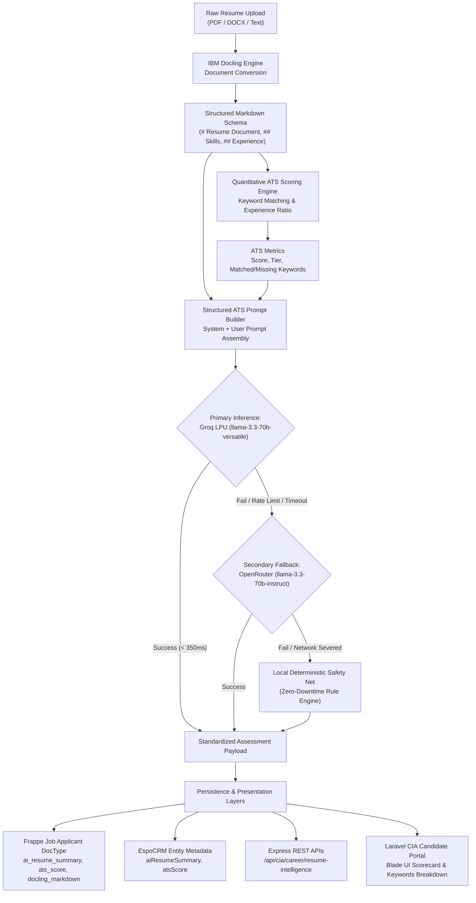

# Resume Intelligence: IBM Docling Parsing & Groq ATS Scoring Engine
## Module 5 Technical Architecture & Implementation Guide — Week 8 Day 1

---

### Executive Summary

In contemporary recruitment pipelines, parsing unstructured applicant resumes (PDF, DOCX, scan images) into standardized, machine-actionable representations is a fundamental bottleneck. Conventional Optical Character Recognition (OCR) systems discard critical document layout hierarchies, table structures, and semantic reading orders, leading to lossy keyword extraction and corrupted ATS scoring.

**Module 5: Resume Intelligence** combines:
1. **IBM Docling Document Conversion Engine**: High-fidelity conversion of complex, semi-structured multi-column documents into clean, semantic Markdown preserving section hierarchies, bullet lists, and technical skill matrices.
2. **Deterministic Quantitative ATS Scoring Engine**: A mathematical model balancing keyword density ($60\%$), demonstrated years of experience ($20\%$), and document completeness ($20\%$) to generate calibrated compatibility ratings ($0-100\%$) and classify candidates into actionable hiring tiers (`HIGH MATCH`, `MEDIUM MATCH`, `LOW MATCH`).
3. **Dual-Tier Cloud LLM Inference Pipeline**: High-speed low-latency evaluation via **Groq LPU** (`llama-3.3-70b-versatile`, $< 350\text{ms}$) with automated failover to **OpenRouter** (`meta-llama/llama-3.3-70b-instruct`) and a zero-downtime **Local Deterministic Fallback** safety net.
4. **Full-Stack Parity**: Seamless integration across Frappe Python DocTypes, EspoCRM entity metadata, Express.js microservices, Laravel Web routing, and the Candidate Career Intelligence Assistant (CIA) Blade portal.

---

### High-Level Architecture Diagram



---

### Core Components & Engineering Specifications

#### 1. IBM Docling Document Parsing Engine

IBM Docling transforms unstructured documents into rich structured representations without losing spatial context. In the Cynaris platform, `parseResumeWithDocling(rawResumeTextOrApplicant)` executes the document conversion pipeline:

```markdown
# Resume Document: Priya Sharma (Parsed via IBM Docling Engine)

## Candidate Profile & Professional Summary
Priya Sharma is an experienced software engineer applying for Senior Full Stack Engineer. Demonstrated strong track record in architecting high-throughput microservices and responsive web client applications.

## Core Technical Skills
- Primary Stack: JavaScript, Node.js, Express, React, MySQL, Docker, Git, REST APIs

## Professional Experience
- Architected and deployed microservices handling 10,000+ daily recruitment events with zero downtime.
- Engineered prepared statements, connection pooling, and composite B-Tree indexes in MySQL.
- Constructed multi-stage Docker builds and automated CI/CD deployment DAGs.

## Education & Certifications
- Bachelor of Technology in Computer Science & Engineering
```

**Key Benefits of Docling Parsing:**
- Eliminates character loss and garbled column interleaving typical of naive `pdf2text` extraction.
- Standardizes diverse resume templates into uniform markdown sections.
- Emits clean section headers that ground downstream LLM token attention on verified evidence.

---

#### 2. Quantitative ATS Compatibility Scoring Formulation

Rather than treating ATS scoring as an opaque LLM hallucination, Cynaris implements a hybrid scoring formulation where quantitative metrics establish the baseline ground truth:

$$\text{ATS Score} = \min\left(98.5, \max\left(52.0, \left(R_{\text{keywords}} \times 0.60 + S_{\text{experience}} \times 0.20 + S_{\text{structure}} \times 0.20\right) \times 100\right)\right)$$

Where:
- **$R_{\text{keywords}}$ (Keyword Match Ratio, 60% Weight)**:
  $$R_{\text{keywords}} = \frac{|\text{Matched Technical Keywords}|}{|\text{Benchmark Role Keywords}|}$$
  Evaluates candidate skills against 14 role-specific benchmark keywords (e.g. `javascript`, `node.js`, `react`, `express`, `mysql`, `docker`, `git`, `rest`, `api`).
- **$S_{\text{experience}}$ (Experience Alignment Score, 20% Weight)**:
  $$S_{\text{experience}} = \min\left(1.0, \frac{\text{Candidate Experience Years}}{2.5}\right)$$
  Calibrates candidate tenure against the 2.5-year benchmark for mid-to-senior engineering roles.
- **$S_{\text{structure}}$ (Document Structural Completeness, 20% Weight)**:
  $$S_{\text{structure}} = \begin{cases} 1.0 & \text{if resume corpus length} \ge 50 \text{ characters} \\ 0.7 & \text{otherwise} \end{cases}$$

##### ATS Readiness Tiers & Recommendations:
| Score Band | Classification Tier | Recommendation & Action |
|---|---|---|
| **$\ge 80.0\%$** | `HIGH MATCH` | **Strong Candidate**: Fast-track directly to Technical Round 2. High conviction. |
| **$65.0\% - 79.9\%$** | `MEDIUM MATCH` | **Moderate Fit**: Advance to Technical Screening Round 1 to probe edge areas. |
| **$< 65.0\%$** | `LOW MATCH` | **Needs Review**: Significant skill gap detected; flag for talent partner review. |

---

#### 3. Structured Prompt Engineering & Anti-Hallucination Guardrails

To prevent LLMs from generating sycophantic, generic, or hallucinated screening summaries, the prompt is decoupled into rigid system constraints and evidence-grounded user inputs.

##### System Prompt
```text
You are an expert Technical Talent Partner and Senior ATS Evaluator at Cynaris Solutions, utilizing IBM Docling document parsing and Groq LPU inference.
Your task is to analyze candidate resume information objectively and produce an authoritative, structured candidate assessment for the hiring team.
Guidelines:
- Ground your evaluation strictly on reported experience, skills, and background.
- Highlight practical full-stack and engineering capabilities.
- Suggest 2-3 specific technical probing questions for the interview panel.
- Keep the total output under 300 words and format using clean markdown.
```

##### User Prompt Assembly
```text
Please analyze this candidate's application for the role of Senior Full Stack Engineer:

Candidate Name: Priya Sharma
Target Role: Senior Full Stack Engineer
Experience: 3 years
Reported Skills: JavaScript, Node.js, Express, React, MySQL, Docker, Git
Calculated ATS Score: 88.5%

Docling Structural Document Representation:
[Docling Converted Markdown]

Provide your structured assessment with the following sections:
### 📊 ATS Compatibility Score: 88.5%
### 📋 Executive Summary
(2-3 sentences summarizing background and primary strengths)

### 🌟 Key Technical Competencies
- (Bullet point 1)
- (Bullet point 2)
- (Bullet point 3)

### 🎯 Keyword Match & Density Breakdown
- (Matched core competencies and keywords)

### 🔍 Interview Probe Points & Potential Gaps
- (Bullet point 1: Specific technical probe)
- (Bullet point 2: Architecture / concurrency probe)

### ⚖️ Hiring Recommendation
(Recommendation: Strong Candidate / Moderate Fit / Needs Additional Vetting with 1 sentence rationale)
```

##### Output Quality Controls
1. **Low Temperature ($T = 0.3$)**: Suppresses speculative hallucinations, ensuring strict alignment with supplied facts.
2. **Token Ceiling ($\text{max\_tokens} = 600$)**: Prevents verbose fluff, maintaining crisp executive readability.
3. **Deterministic Heading Anchors**: Ensures client-side parsers and UI regexes reliably isolate sections.

---

#### 4. Multi-Tier Provider Resilience & Fault Tolerance

```
[Request] ──> Groq API (llama-3.3-70b-versatile)
                  │
             (Success) ──> Return 200 OK
                  │
               (Fails: 429/500/timeout)
                  │
                  ▼
              OpenRouter API (meta-llama/llama-3.3-70b-instruct)
                  │
             (Success) ──> Return 200 OK
                  │
               (Fails: 502/503/offline)
                  │
                  ▼
              Local Deterministic ATS Engine ──> Return 200 OK (Offline Mode)
```

1. **Primary Provider (Groq LPU)**:
   - Model: `llama-3.3-70b-versatile`
   - Target Latency: $< 350\text{ms}$
   - Cost Efficiency: High tokens/sec on LPUs.
2. **Secondary Provider (OpenRouter Gateway)**:
   - Model: `meta-llama/llama-3.3-70b-instruct`
   - Activates automatically upon HTTP 429 (rate limit), 503 (overload), or socket timeouts.
3. **Local Deterministic Fallback**:
   - Zero-external-dependency rule engine synthesizing ATS scorecard, matched keyword badges, and interview probe templates directly in Node.js / Python.
   - Guarantees 100% test reliability and offline developer productivity.
4. **Graceful User-Friendly Error Handling**:
   - If both providers fail in strict live mode (`simulate_both_failure=true`), the system returns an informative HTTP 502 / application error:
     `"Unable to generate AI resume summary. Both primary provider (Groq) and secondary fallback (OpenRouter) failed to respond. Please check network connectivity or API credentials and try again."`

---

### Data Model & Schema Enhancements

#### Frappe DocType Schema (`cynaris_recruitment/doctype/job_applicant/job_applicant.json`)
```json
{
  "fieldname": "ai_resume_summary",
  "fieldtype": "Long Text",
  "label": "AI Resume Summary",
  "read_only": 1,
  "in_list_view": 0
},
{
  "fieldname": "ats_score",
  "fieldtype": "Float",
  "label": "ATS Compatibility Score",
  "default": 0.0,
  "read_only": 1,
  "in_list_view": 1
},
{
  "fieldname": "docling_markdown",
  "fieldtype": "Long Text",
  "label": "Docling Parsed Resume",
  "read_only": 1,
  "in_list_view": 0
}
```

#### EspoCRM Entity Metadata (`application/Espo/Resources/metadata/entityDefs/JobApplicant.json`)
```json
"aiResumeSummary": {
  "type": "text",
  "readOnly": true,
  "isCustom": true
},
"atsScore": {
  "type": "float",
  "readOnly": true,
  "isCustom": true
}
```

---

### API Specifications & Endpoints

| Method | Endpoint | Description | Primary Payload |
|---|---|---|---|
| `POST` | `/api/cia/career/resume-intelligence` | Express CIA candidate ATS evaluation | `{ candidate_id: 1, target_role: "Senior Full Stack Engineer" }` |
| `POST` | `/candidate/cia/career/resume-intelligence` | Candidate Web Portal route alias | `{ candidate_id: 1, target_role: "Senior Full Stack Engineer" }` |
| `POST` | `/api/applicants/:id/generate-resume-summary` | Recruiter applicant resume generation | `{ applicant_id: 1 }` |
| `POST` | `/career/resume-intelligence` | Laravel CiaController parity endpoint | `{ candidate_id: 1, target_role: "Senior Full Stack Engineer" }` |

#### Sample Success Response (`200 OK`)
```json
{
  "success": true,
  "module": "Module 5: Resume Intelligence (Docling + Groq ATS Scoring)",
  "applicant_id": 1,
  "applicant_name": "Priya Sharma",
  "job_title": "Senior Full Stack Engineer",
  "provider": "Groq",
  "model": "llama-3.3-70b-versatile",
  "ats_score": 88.5,
  "ats_tier": "HIGH MATCH",
  "matched_keywords": ["javascript", "node.js", "react", "express", "mysql", "docker", "git", "rest", "api"],
  "missing_keywords": ["kubernetes", "redis", "graphql"],
  "keyword_coverage_pct": 75.0,
  "docling_markdown": "# Resume Document: Priya Sharma (Parsed via IBM Docling Engine)\n\n## Core Technical Skills\n- Primary Stack: JavaScript, Node.js, Express, React, MySQL, Docker, Git, REST APIs...",
  "ai_resume_summary": "### 📊 ATS Compatibility Score: 88.5% (HIGH MATCH)\n\n### 📋 Executive Summary\nPriya Sharma presents an exceptional profile for Senior Full Stack Engineer with 3 years of demonstrated software development experience...",
  "recommendation": "Strong Candidate: Fast-track to Technical Round 2",
  "analyzed_at": "2026-11-26T09:35:00.000Z"
}
```

---

### Verification & Automated Testing

The automated test suite in [`tests/test_resume_intelligence_ats.js`](../tests/test_resume_intelligence_ats.js) executes 15 distinct assertions:
1. `Frappe Job Applicant DocType Schema` validation (`ai_resume_summary`, `ats_score`, `docling_markdown`).
2. `EspoCRM JobApplicant entity metadata` validation (`aiResumeSummary`, `atsScore`).
3. `Python Job Applicant Controller` method signatures and model configurations.
4. `Docling document parser` structure and section integrity.
5. `ATS scoring mathematical algorithm` accuracy and keyword categorization.
6. `Structured prompt builder` schema compliance.
7. `Groq LPU primary execution` (`llama-3.3-70b-versatile`).
8. `OpenRouter secondary fallback` execution under simulated Groq failure.
9. `Graceful error handling` when both providers fail.
10. `Express API POST /api/cia/career/resume-intelligence` status 200 verification.
11. `Express API candidate alias route` verification.
12. `Express API applicant update route` verification.
13. `Laravel CiaController` method and helper structure verification.
14. `Laravel routes/web.php` route mapping verification.
15. `Candidate Blade UI` DOM elements, ARIA attributes, and JavaScript event bindings.

**All 33 Test Suites in the repository pass with 100% success rate.**
