# Week 7 Day 5: Internship Submission Report

**Topic:** Module 4: Learning Path Generator — LangGraph Workflow  
**Student Name:** Murali  
**Branch:** `feat/cynaris-w7d5-murali`  
**Date:** November 26, 2026  
**Repository:** Cynaris Recruitment Platform  
**Overall Test Status:** 32/32 Test Suites Passing (100% Pass Rate)  
**Day Test Suite:** `tests/test_langgraph_learning_path.js` (14/14 Tests Passing)

---

## 1. Executive Summary & Accomplishments

In Week 7 Day 5, I engineered and deployed **Module 4: Learning Path Generator** using an autonomous **LangGraph State Machine Workflow** for the Cynaris Recruitment Platform. The system breaks down curriculum synthesis into five specialized, sequential nodes, maintaining a shared state container across the entire trajectory, validating pedagogical feasibility, and producing an interactive 8-week Mermaid timeline diagram.

### Key Deliverables Completed:
1. **LangGraph State Machine Architecture:**
   - Designed 5-node workflow: `AssessCurrentState` $\to$ `IdentifyGaps` $\to$ `GeneratePlan` $\to$ `ValidatePlan` $\to$ `OutputPlan`.
   - Built state container carrying `intern_profile`, `skill_gaps`, `target_role`, `generated_plan`, and `node_history`.
2. **Pedagogical 8-Week Curriculum Generation:**
   - Synthesizes week-by-week learning schedule with concrete technical topics, Moodle course references (`CYN-FS-101`, `CYN-OPS-103`, `CYN-AI-201`), daily commitment hours, and measurable capstone deliverables.
3. **Rigorous Plan Validation (Critic Node):**
   - Implemented `ValidatePlan` checking: exactly 8 weeks, non-empty topics and resources, daily commitment $\le 3.5\text{ hrs/day}$, and alignment with identified gaps.
4. **Interactive Mermaid Timeline Synthesis:**
   - Generates valid Mermaid `timeline` syntax with sections (`Foundations & Core Architecture`, `Data & Storage Engine`, `Containerization & Cloud CI/CD`, `AI Systems & Capstone`) and week-by-week events.
5. **Dual-Stack API Parity:**
   - **Express REST Gateway:** `POST /api/cia/career/learning-path` and `/candidate/cia/career/learning-path` in [`backend/routes/ciaRouter.js`](../backend/routes/ciaRouter.js).
   - **Laravel Web Route & Controller:** `POST /candidate/cia/career/learning-path` in [`app/Http/Controllers/Web/CiaController.php`](../app/Http/Controllers/Web/CiaController.php) & [`routes/web.php`](../routes/web.php).
6. **Frontend UI Deck with ARIA Live Region:**
   - Enhanced [`resources/views/candidate/cia.blade.php`](../resources/views/candidate/cia.blade.php) with an accessible `#langgraph-learning-path-section`, interactive trigger button `#btn-generate-learning-path`, dynamic Mermaid timeline container `#langgraph-mermaid-timeline-box`, and 8 weekly curriculum cards.
7. **Automated Unit Testing & Parity:**
   - Authored [`tests/test_langgraph_learning_path.js`](../tests/test_langgraph_learning_path.js) (14/14 tests passing).
   - Verified that all **32 test suites in the repository pass with 100% success** via `npm test`.

---

## 2. Architecture & Data Flow

```mermaid
sequenceDiagram
    autonumber
    actor Candidate as Candidate / Intern
    participant View as cia.blade.php (#langgraph-learning-path-section)
    participant Controller as CiaController / Router
    participant Service as CareerIntelligenceService (LangGraph)
    participant Groq as Groq Primary (llama-3.3-70b-versatile)
    participant OpenRouter as OpenRouter Secondary Fallback
    participant LocalEngine as Local Deterministic State Engine

    Candidate->>View: Click "Generate 8-Week Learning Path"
    View->>Controller: POST /candidate/cia/career/learning-path
    Controller->>Service: executeLangGraphLearningPathWorkflow(input)
    
    rect rgb(240, 248, 255)
        Note over Service: Node 1: AssessCurrentState
        Service->>Service: Evaluate verified skills & baseline readiness
        Service->>Service: Push 'AssessCurrentState' to node_history
    end

    rect rgb(245, 240, 255)
        Note over Service: Node 2: IdentifyGaps
        Service->>Service: Calculate quantitative skill gaps & critical missing skills
        Service->>Service: Push 'IdentifyGaps' to node_history
    end

    rect rgb(240, 255, 240)
        Note over Service, Groq: Node 3: GeneratePlan
        Service->>Groq: Generate 8-Week Schedule JSON
        alt Groq Success
            Groq-->>Service: Valid 8-Week Schedule JSON
        else Groq Outage / Timeout
            Service->>OpenRouter: Failover to OpenRouter
            alt OpenRouter Success
                OpenRouter-->>Service: Valid 8-Week Schedule JSON
            else Dual Cloud Outage
                Service->>LocalEngine: Deterministic 8-Week Plan
            end
        end
        Service->>Service: Push 'GeneratePlan' to node_history
    end

    rect rgb(255, 248, 240)
        Note over Service: Node 4: ValidatePlan
        Service->>Service: Assert exactly 8 weeks, valid daily commitment, non-empty fields
        Service->>Service: Push 'ValidatePlan' to node_history
    end

    rect rgb(255, 240, 245)
        Note over Service: Node 5: OutputPlan
        Service->>Service: Calculate total hours & synthesize Mermaid timeline syntax
        Service->>Service: Push 'OutputPlan' to node_history
    end

    Service-->>Controller: Return State (node_history, generated_plan, mermaid_timeline)
    Controller-->>View: JSON Response (HTTP 200)
    View->>View: Render Mermaid Timeline & 8 Weekly Curriculum Cards
    View-->>Candidate: Visual Interactive Roadmap Displayed
```



---

## 3. Viva Voce Questions & Answers

### Question 1: "Walk me through your implementation — what did you build and why did you structure it that way?"

**Answer:**
"In Week 7 Day 5, I built an enterprise **Learning Path Generator** powered by a **5-Node LangGraph State Machine Workflow**. 

I structured the architecture as a state graph rather than a monolithic LLM prompt for three critical engineering reasons:
1. **Decoupled State Transitions:** Monolithic prompts that ask an LLM to simultaneously evaluate a student, deduce their gaps, schedule 8 weeks of study, and validate pedagogical balance frequently suffer from hallucinated hours, dropped prerequisites, or missing topics. By breaking the workflow into discrete nodes—`AssessCurrentState`, `IdentifyGaps`, `GeneratePlan`, `ValidatePlan`, and `OutputPlan`—each node owns a single responsibility and transforms a shared, observable state container carrying `intern_profile`, `skill_gaps`, `target_role`, and `generated_plan`.
2. **Explicit Critic Validation Node (`ValidatePlan`):** In a production EdTech setting, recommending an unrealistic schedule (like 6 hours of study a day to an intern with full-time college commitments) results in dropouts. Node 4 acts as an invariant critic: it programmatically validates that the plan spans exactly 8 weeks, that daily commitments are capped at $\le 3.5\text{ hrs/day}$, that every week contains concrete technical topics and Moodle course resources (`CYN-FS-101`, `CYN-OPS-103`), and that every identified gap from Node 2 is addressed.
3. **Multi-Format Visual Output (`OutputPlan`):** The final node synthesizes both a machine-readable JSON structure for frontend card rendering and a valid **Mermaid timeline diagram** string. This allows candidate portals to render interactive visual progress charts dynamically without relying on proprietary third-party charting libraries.

Both Express and Laravel backends expose this capability via `POST /candidate/cia/career/learning-path` with zero downtime thanks to our multi-tier fallback cascade (Groq $\to$ OpenRouter $\to$ Local Deterministic Engine)."

---

### Question 2: "What was the most challenging part and how did you solve it?"

**Answer:**
"The most challenging part was **generating strictly valid, aesthetically balanced Mermaid timeline diagram syntax from dynamic, multi-topic curriculum payloads while ensuring resilient parsing across both LLM and deterministic execution paths**.

Mermaid timeline diagrams have strict syntax constraints:
- They require a root `timeline` declaration, an optional `title`, and sections declared with `section <Name>`.
- Within a period, events are separated by colons (`:`), meaning if a generated topic or milestone contains unescaped colons (e.g. `'Topics: Node.js: Event Loop'`) or ampersands (`&`), Mermaid's lexer crashes and fails to render the timeline entirely.

I solved this through a two-step normalization pipeline in Node 5:
1. **Semantic Section Partitioning:** I mapped the 8 weeks into 4 distinct thematic sections:
   - Weeks 1–2: *Foundations & Core Architecture*
   - Weeks 3–4: *Data & Storage Engine*
   - Weeks 5–6: *Containerization & Cloud CI/CD*
   - Weeks 7–8: *AI Systems & Production Capstone*
2. **Token Sanitization Engine:** In `generateMermaidTimeline()`, I implemented regex sanitization that replaces colons and ampersands with safe connective prose (`and`), trims titles, and limits each week line to three clean tokens (`Week N : Title : Core Topic : Practical Milestone`).
3. **Graceful Client-Side Re-hydration:** On the frontend, after updating the `<pre class="mermaid">` element, the code removes the `data-processed` attribute and calls `mermaid.run()`, wrapped in a `try/catch` block so that if a browser extension interferes with Mermaid, the fallback visual cards continue rendering without breaking UI interactivity."

---

### Question 3: "If you had one more day, what would you improve?"

**Answer:**
"If I had one additional day, I would implement three key architectural enhancements:

1. **Conditional State Graph Cycles (Human-in-the-Loop Feedback):**
   In LangGraph, edges can be conditional. If `ValidatePlan` flags that the candidate cannot commit 2.0 hours a day due to exam schedules, rather than throwing an error, the state graph would route back to `GeneratePlan` with an adjusted constraint (e.g. 1.0 hr/day extending the timeline to 12 weeks), or prompt the intern with an interactive 'Accept Adjusted Commitment' step.
2. **Deep Dynamic Moodle Grade Book Synchronization:**
   Currently, the engine uses verified skills from the candidate profile. I would connect the `AssessCurrentState` node directly to Moodle's `mdl_grade_grades` and `mdl_course_completions` tables via the Cynaris Moodle API bridge, automatically adjusting week topics based on actual quiz scores in real time.
3. **Calendar Integration (.ics / Google Calendar Export):**
   I would add a one-click 'Export to Calendar' button that converts the 8-week daily study schedule into an iCalendar (`.ics`) file with daily reminders aligned with the candidate's quiet hours preferences from Week 4 Day 2."

---

## 4. Verification & Automated Test Results

### 4.1 Unit Test Suite (`tests/test_langgraph_learning_path.js`)
```
================================================================
🧪 Week 7 Day 5: LangGraph Workflow Learning Path Generator
================================================================
  [PASS] 1. Initial state correctly encapsulates intern_profile, skill_gaps, target_role, generated_plan
  [PASS] 2. Node 1: AssessCurrentState evaluates baseline verified competencies
  [PASS] 3. Node 2: IdentifyGaps calculates quantitative gaps and isolates critical missing skills
  [PASS] 4. Node 3: GeneratePlan produces 8-week curriculum adhering to schema
  [PASS] 5. Node 4: ValidatePlan enforces 8-week invariant and daily commitment limits
  [PASS] 6. Node 5: OutputPlan synthesizes valid Mermaid timeline syntax and hours metrics
  [PASS] 7. executeLangGraphLearningPathWorkflow sequences all 5 nodes strictly
  [PASS] 8. Every week in 8-week schedule contains title, topics, resources, commitment, and milestone
  [PASS] 9. ValidatePlan rejects unrealistic daily commitments (> 3.5 hrs/day)
  [PASS] 10. Groq primary engine configured with llama-3.3-70b-versatile
  [PASS] 11. OpenRouter secondary fallback activates seamlessly on simulated Groq error
  [PASS] 12. Local deterministic engine guarantees 100% test reliability on dual cloud outage
  [PASS] 13. Laravel Parity: CiaController::learningPath, routes/web.php, and cia.blade.php
  [PASS] 14. Express API: POST /api/cia/career/learning-path and alias return 200 with full 5-node state
================================================================
🎉 Summary: 14/14 tests passed successfully!
================================================================
```

### 4.2 Full Repository Test Suite (`npm test`)
- Total Test Suites: **32 suites**
- Pass Rate: **100% (All 32 suites passing)**
- Zero regressions across EspoCRM, React Virtual DOM, Moodle LMS, Stateless JWT, Docker, LlamaIndex RAG, CrewAI, ChromaDB, and LangGraph modules.

---

## 5. Self-Review Checklist

- [x] Branch named `feat/cynaris-w7d5-murali` created and verified.
- [x] LangGraph state machine designed with nodes: `AssessCurrentState` $\to$ `IdentifyGaps` $\to$ `GeneratePlan` $\to$ `ValidatePlan` $\to$ `OutputPlan`.
- [x] State carries `intern_profile`, `skill_gaps`, `target_role`, `generated_plan`.
- [x] Week-by-week learning schedule for 8 weeks with topics, resources, and daily time commitment.
- [x] Endpoint `POST /candidate/cia/career/learning-path` implemented in Laravel and Express.
- [x] Output rendered as interactive timeline in CIA using Mermaid timeline diagram type.
- [x] Multi-tier resilience: Groq primary (`llama-3.3-70b-versatile`) + OpenRouter fallback + local deterministic engine.
- [x] Unit test suite `tests/test_langgraph_learning_path.js` (14/14 passing).
- [x] `package.json` updated with `"test:w7d5"`, `"test"` updated, keywords added.
- [x] Full test suite `npm test` verified: all 32 suites passing.
- [x] Complete Viva Voce answers documented in submission report.
- [x] CIA usage logged (Mentor & Code modes).
- [x] Conventional commits prepared.
